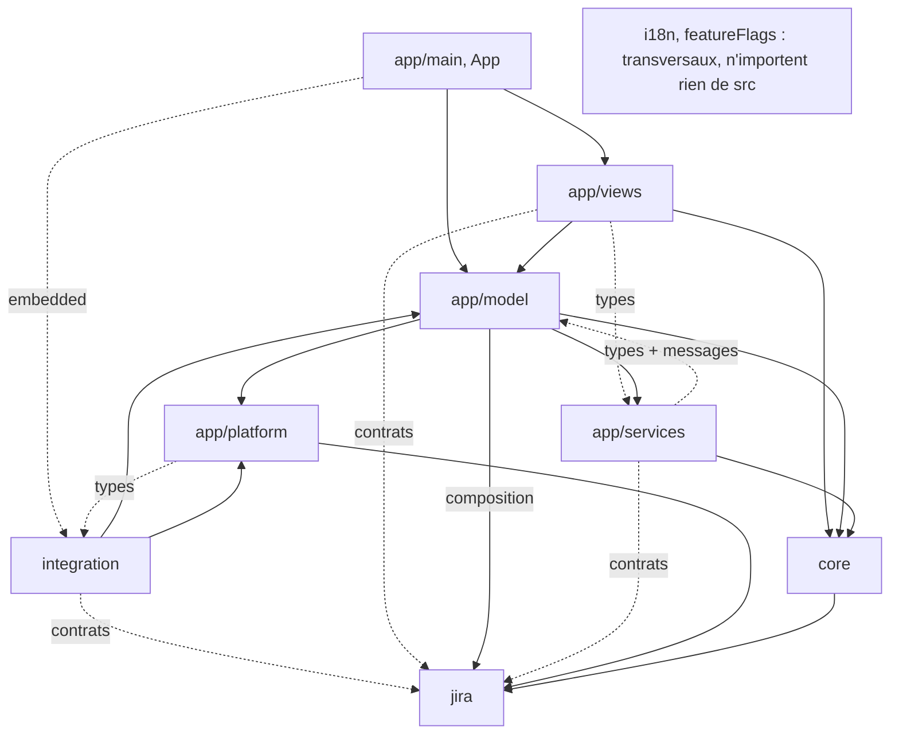
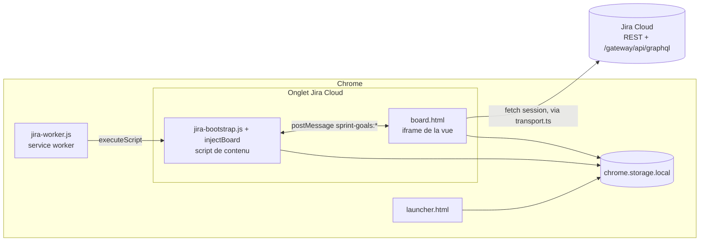

# Architecture Spine — Sprint Goals Board pour Jira

Contrat de cohérence et carte des modules. La [documentation technique](../../../../docs/technique/index.md) reste la référence des comportements (invariants, contrats API, inventaire E1–E9, données persistantes, sécurité S1–S12) ; [AGENTS.md](../../../../AGENTS.md) porte les règles produit. Cette spine ne les recopie pas : elle fixe les règles de structure qu'un agent ne déduit pas du code.

## Design Paradigm

Couches à noyau métier lié à Jira : `core` dépend des **contrats** de `jira`, jamais l'inverse. Pas d'inversion hexagonale (voir Deferred).

| Couche | Répertoire | Rôle |
|---|---|---|
| Entrée | `src/app/main.tsx`, `App.tsx` | Démarrage de la vue encadrée et routage des vues |
| Intégration | `src/integration/` | Service worker, script de contenu, injection, lanceur, garde d'encadrement |
| Vues | `src/app/views/` | Composants Preact |
| Modèles | `src/app/model/` | Signaux, façades des vues, stores locaux, racine de composition |
| Services | `src/app/services/` | Cas d'usage déclenchés par geste, via ports |
| Plateforme | `src/app/platform/` | Adaptateurs Chrome injectés |
| Noyau | `src/core/` | Règles métier et orchestration des écritures |
| Jira | `src/jira/` | Transport, client, Goals GraphQL, inventaire des écritures |
| Transversal | `src/i18n/`, `src/app/i18n.ts`, `src/app/featureFlags.ts` | Catalogues FR/EN/ES et sélection pure de langue, adaptateur réactif de langue, interrupteurs |
| Pages | `board.html`, `launcher.html` | Vue Preact intégrée ; lanceur/bienvenue sans lecture de tickets |
| Manifest | `public/manifest.json` | Permissions, CSP, identité et entrées compilées |
| Tests | `tests/support/`, `tests/harness/` | Faux services et banc visuel, absents de la distribution |
| Outillage | `scripts/`, `.run/` | Contrôles navigateur, distribution et configurations IntelliJ partagées |

## Invariants & Rules

### AD-1 — Sens des dépendances [ADOPTED]

- **Binds:** all
- **Prevents:** `jira` dépendant du métier ; logique métier couplée à l'implémentation réseau ; transports multiples hors de la composition ; inversion hexagonale future coûteuse.
- **Rule:** Les imports suivent le graphe ci-dessus ; une flèche pointillée n'admet que ce qu'elle nomme. **Contrats** de `jira` = types, classes d'erreur, constantes et fonctions pures sans E/S. `jira` n'importe jamais `core`, `app`, `integration`, ni DOM ni `chrome.*`. **Racine de composition** : seuls `AppModel`, `BoardModel` et `DiagnosticModel` construisent `JiraTransport`, `JiraClient`, `GoalsClient` et `AuditLog` ; tout autre module les reçoit par injection. Les services n'importent des modèles que des types et `model/messages.ts`, jamais `BoardModel`. Les vues n'importent des services que des types. `platform` peut implémenter une interface déclarée par son consommateur (`integration/LauncherModel.ts`), en import de type. `src/i18n/` et `featureFlags.ts` n'importent rien de `src/` hors d'eux-mêmes ; un contenu Jira n'est jamais localisé. `tests/guards/sources.test.ts` est la traduction exécutable de ce graphe et doit le suivre.

### AD-2 — Écritures Jira : inventaire, une fonction core par intention [ADOPTED]

- **Binds:** E1–E9, `core`, `app/services`, `app/model`
- **Prevents:** deux ordres d'opérations pour la même intention ; orchestration dispersée hors de `core` ; inventaire contourné ; écriture sans relecture.
- **Rule:** Une écriture n'existe que comme valeur `JiraWrite`/`GraphqlWrite` de `jira/writes.ts`, exécutée uniquement par un `JiraWriter` (`Pick<JiraTransport, "write">`) ou `goals.setLink`. Chaque intention métier (déplacer, rattacher à un objectif quel que soit `goalsOrigin`, classer, épingler, publier les réglages, publier le planning, tester le diagnostic) a **une seule** fonction de `core`, qui porte séquence, relecture conditionnant l'écriture, arrêt au premier échec et résultat partiel, et renvoie un résultat typé. Un nouveau geste réutilise cette fonction, sans en créer de variante. Un service déclenche sur geste explicite, gère file, droits et journal, traduit le résultat en avis, et peut seulement décorer le `JiraWriter` (garde de péremption ou de droits). Vues et `platform` n'écrivent jamais. Seule exception : E7, interne à `jira/diagnostics.ts`.

### AD-3 — État réactif détenu par les modèles [ADOPTED]

- **Binds:** `app/model`, `app/views`, `app/services`, `integration/LauncherModel.ts`
- **Prevents:** mutations d'état dispersées dans les vues ; services couplés au moteur de signaux.
- **Rule:** Seuls les modèles (dont `integration/LauncherModel.ts`) et l'adaptateur `app/i18n.ts` créent des signaux. Les vues lisent les signaux et appellent des méthodes de modèle, sans affecter de signal. Les services ne voient l'état que par les ports de `app/services/ports.ts`, sans importer Preact ni signals.

### AD-4 — Un module propriétaire par donnée persistée [ADOPTED]

- **Binds:** propriétés `com.scrumboardmac.*`, clés `chrome.storage.local`
- **Prevents:** formats réinventés ; lecture des anciennes données cassée ; extensions de format perdues par un autre écrivain ; politiques de conflit divergentes sur une même propriété ; données d'un site survivant à la déconnexion.
- **Rule:** Chaque propriété Jira et chaque clé locale a un unique module propriétaire qui seul décode, encode et migre son format ; les autres modules passent par lui. Clés versionnées, version inconnue ou donnée illisible jamais écrasée, clés inconnues conservées à tous les niveaux. Un doublon n'est toléré que s'il est imposé par l'absence d'import de `bootstrap.ts` (`language.v1`, `jira-button-position.v1:<origine>`), nommé ici et couvert par un test.
  - **Propriétés Jira** : le module propriétaire expose la **seule** primitive de mise à jour (relecture, mutation pure fournie par l'appelant, écriture) et fixe lui-même la règle de conflit et le format d'horodatage. Pour `sprintgoals.v1` : fusion sur Jira frais quand la mutation ne touche qu'un lien, refus si la zone modifiée a changé depuis la version de base. Les fonctions de `core` qui écrivent ne fournissent qu'une mutation du document décodé. Une entité stockée dans plusieurs propriétés (Goals épinglés : `sprintgoals.v1` en Scrum, `boardsettings.v1` en Kanban) a un seul résolveur de stockage dans `core` ; aucun geste ne choisit la propriété.
  - **Clés locales** : une nouvelle clé contenant des données d'un site est suffixée par l'origine (`<clé>.vN:<origine Jira>`). Son module propriétaire exporte `forgetSite(origin)`, enregistré dans la liste unique `app/model/siteData.ts` appelée par la déconnexion ; les clés existantes en carte par site (`boards.v1`, `dismissedNotices.v1`, `graphqlOrigin.v1`, `audit.v1`) gardent leur format et passent par la même liste. Une clé sans donnée de site y est déclarée explicitement (`language.v1`, `interface.v1`, `loadDiagnostics.v1`). Les écritures concurrentes entre onglets ne sont pas fusionnées : la dernière écriture gagne, et c'est accepté.

### AD-5 — Interrupteurs de fonction à la compilation [ADOPTED]

- **Binds:** fonctions expérimentales ou masquées
- **Prevents:** mécanismes d'activation concurrents ; fonction expérimentale active en production ; données d'un build `dist/` illisibles dans le paquet.
- **Rule:** Tout interrupteur se déclare dans `app/featureFlags.ts` et se fixe à la compilation. Aucune préférence locale, réglage partagé ou URL ne l'active. Une fonction expérimentale est désactivée dans le paquet `npm run package`. La garde porte sur chaque point d'entrée du modèle ou service qui lit ou écrit pour la fonction, pas seulement sur la vue ; décodage, conservation des formats et effacement ne sont jamais conditionnés.

### AD-6 — Porte d'écriture unique par board [ADOPTED]

- **Binds:** tout geste qui écrit dans Jira depuis la vue d'un board (E1–E6, E8, E9)
- **Prevents:** deux gestes écrivant en parallèle sur le même ticket ou la même propriété ; projection `pendingMove` contournée ; une même écriture autorisée ou refusée selon le geste.
- **Rule:** `BoardModel` détient la seule file d'écritures Jira du board. Tout geste l'acquiert avant d'écrire ; aucun service ni modèle ne crée sa propre file. Le `JiraWriter` remis à `core` est toujours le décorateur fourni par cette porte (péremption de génération, droits), jamais le `JiraTransport` brut. Droits : `canEdit` pour E6 uniquement ; E1–E5, E8 et E9 sont laissés aux droits Jira. E7 (diagnostic) reste hors du board.

### AD-7 — Protocole hôte ↔ vue déclaré une seule fois [ADOPTED]

- **Binds:** `src/integration/`, `app/platform/launcherChrome.ts`, messages `sprint-goals:*`
- **Prevents:** un message étendu côté vue et rejeté silencieusement côté hôte ; types de message ajoutés sans validation.
- **Rule:** Les types `sprint-goals:*` (canal `postMessage` ou `chrome.runtime`, sens, schéma de charge utile, validation) sont déclarés dans une liste unique `src/integration/messages.ts`, utilisée par tout module qui peut importer. Doublons nommés, imposés par l'absence d'import ou par AD-1, chacun entre les marqueurs `<protocole sprint-goals>` : copie complète dans `injectBoard.ts` (copié par `executeScript`), avec le même bloc `<validation sprint-goals>` que `messages.ts` ; `launch` dans `bootstrap.ts` ; `prepareLaunch` dans `app/platform/launcherChrome.ts`. `tests/integration/messages.test.ts` compare chaque copie et le code de validation, et refuse tout littéral `sprint-goals:` hors de ces blocs. Origine et fenêtre source restent vérifiées dans les deux sens.

## Modules et flux

[`AppModel`](../../../../src/app/model/AppModel.ts) pilote connexion et présentation ;
[`BoardModel`](../../../../src/app/model/BoardModel.ts) reste la façade des vues : signaux, état visuel,
filtres et méthodes publiques. Trois services dans `src/app/services/` portent les opérations :

| Service | Responsabilité |
|---|---|
| `BoardLoadingService` | Synchronisation, relance des lectures concurrentes, résultats périmés, types observés et diagnostic |
| `BoardMovementService` | Déclenche le déplacement (`core/boardMove`), délégation native, avis des erreurs partielles et journal |
| `BoardSettingsService` | Réglages partagés (`core/teamSettings.saveTeamSettings`) et épinglage Scrum/Kanban écrits par la porte du board, avis des conflits et permissions |

Toute écriture Jira du board passe par [`BoardWriteGate`](../../../../src/app/model/BoardWriteGate.ts),
détenue par `BoardModel` : file unique des gestes (déplacement, rattachement, réglages, épinglage,
publication du planning) et décorateur remis à `core` (péremption de génération, `canEdit` pour E6).

Leurs ports décrivent les seuls états et effets nécessaires ; ils n'importent ni `BoardModel`,
ni les vues, ni Preact, ni le DOM ou Chrome. Les types communs sont dans `BoardTypes.ts`, réexportés
par la façade pour conserver les imports existants. Les adaptateurs réels sont assemblés dans
le constructeur du modèle ; les tests peuvent fournir des états ordinaires et des services fictifs.

`boardSync` lit le périmètre, `boardIssue` assemble les cartes, `boardLayout`/`boardBlocks` les
répartissent ; `pendingMove` projette les déplacements. `dropPlan` prépare l'intention,
`boardMove` l'exécute (transition → Goal → rang, détacher → lier) avec les primitives de `boardWrites`. `teamSettings` gère le partage, `pinnedGoals` résout le stockage des Goals épinglés (sprint, board ou
indisponible), `boardStore` la copie locale
et le board actif par origine, `auditLog` les écritures. `DiagnosticModel` teste les capacités Jira.

L'ouverture relit structure, statuts et champs, sans parcourir l'historique pour recenser les types.
Les types connus du même site/board et ceux des réglages partagés restent présents même sans ticket.
[`issueTypeDiscovery`](../../../../src/core/issueTypeDiscovery.ts) les complète depuis les tickets utiles,
avant les Goals et l'assemblage : catégories et groupes choisis sont conservés ;
seuls les types nouveaux sans choix partagé reçoivent un défaut. Les métadonnées sont mémorisées
localement dès lecture des tickets, même si les Goals échouent ensuite, sans écriture Jira.
La relecture explicite de structure conserve le recensement exhaustif et paginé.

[`LoadDiagnostics`](../../../../src/app/model/LoadDiagnostics.ts) et [`LoadTrace`](../../../../src/jira/loadTrace.ts) mesurent les phases et lectures
sans appel réseau supplémentaire ; écritures et images sont exclues. Horloge monotone, départ à
la navigation du document de l'extension (navigation Jira précédente hors mesure), rendu estimé
après deux frames. Les durées parallèles ne s'additionnent pas ; une relecture de structure pendant
la synchronisation prolonge la mesure. **Aucun indicateur ni accès à la popin dans Jira.**
La vue subsiste uniquement sur le banc `?scenario=board-chargement` ; `verify:loading` contrôle
copie, historique, fermeture et format étroit, avec captures dans `.vite/`.

## Consistency Conventions

| Concern | Convention |
| --- | --- |
| Textes visibles | Uniquement dans les catalogues `src/i18n` : français source, anglais repli, espagnol complet |
| Contenus Jira | Rendus en texte Preact, jamais passés à `localize` |
| Erreurs et messages | `JiraError` côté `jira` ; `core` renvoie des résultats typés ou des clés du catalogue, jamais de phrase ; les modèles produisent le texte ; le journal `audit.v1` stocke clé + paramètres |
| Lectures Jira | Par `JiraClient`/`GoalsClient` et les endpoints documentés dans [integration-jira.md](../../../../docs/technique/integration-jira.md#contrats-api), jusqu'à décision sur les endpoints « enhanced » |
| Tests | Faux services et données fictives uniquement sous `tests/` |
| Langue | Commentaires et commits en français |

## Stack

Versions relevées le 27/10/2026 ; `package.json` et `package-lock.json` font foi.

| Name | Version |
| --- | --- |
| Chrome Manifest | V3, Chrome ≥ 116 |
| TypeScript | 7.0.2 |
| Preact | 10.29.8 |
| @preact/signals | 2.11.2 |
| Vite | 8.3.0 |
| Vitest | 5.0.1 |
| Biome | 2.5.14 |
| Node.js (outillage) | ≥ 22.12.0 |

## Structural Seed

Aucun serveur ni télémétrie. Environnements : build local `dist/` (Sprint Planning actif), paquet `npm run package` pour le Chrome Web Store (fonctions expérimentales désactivées). Contrôles : `npm run check`, `npm run verify:*`.

## Écarts à résorber

Le code actuel s'écarte de la spine sur ces points. Un agent ne les prend jamais pour précédent.

| Règle | Écart |
| --- | --- |
| AD-5 | `SPRINT_HEALTH_ENABLED` (`views/board/BoardView.tsx`) et `DIAGNOSTIC_ENABLED` (`views/DiagnosticView.tsx`) à migrer dans `app/featureFlags.ts` |
| Conventions | `core/sprintPlanning.ts` et `core/boardWrites.ts` produisent des phrases utilisateur, persistées ensuite dans `audit.v1` puis relocalisées par motifs |

## Deferred

- **Inversion hexagonale** (ports définis par `core`, implémentés par `jira`) : à reconsidérer si une seconde source de données apparaît ou si tester `core` sans les types Jira devient pénible. AD-1 sera amendé sur place.
- **Endpoints Software « enhanced »** : décision produit ouverte dans le [backlog](../../backlog.md) ; d'ici là, convention « Lectures Jira ».
- **Canal de publication et de mise à jour** (Store, `storage.managed`) : décision produit ouverte dans le [backlog](../../backlog.md).
- **Contrats API, inventaire des écritures, sécurité** : détenus par la [documentation technique](../../../../docs/technique/index.md) et `jira/writes.ts`, non repris ici.
