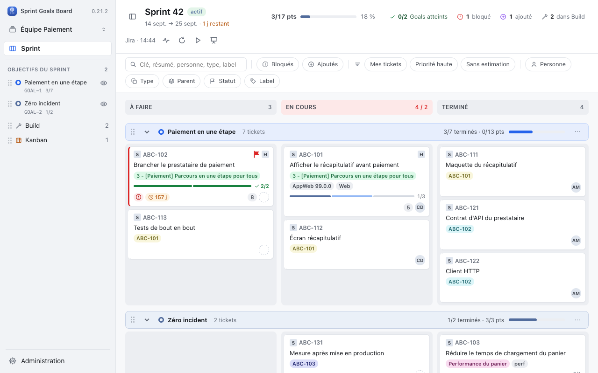
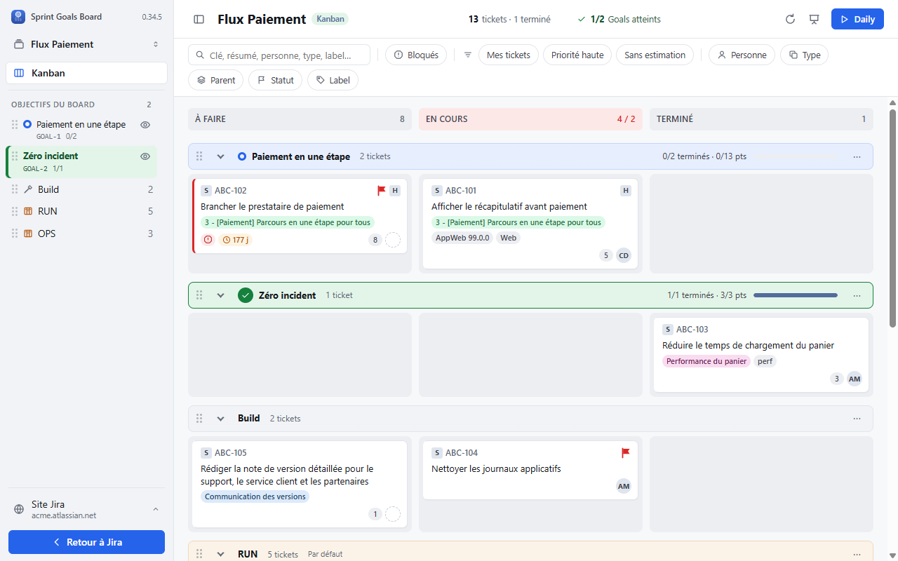
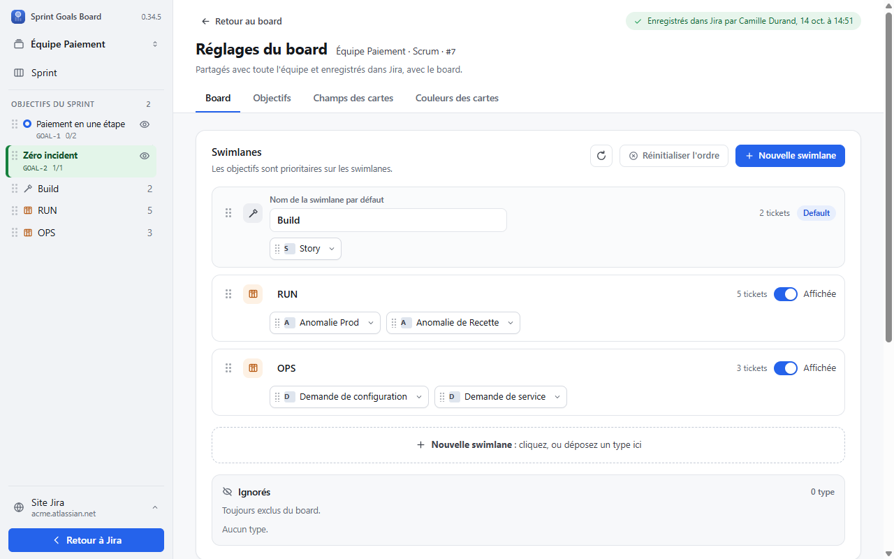
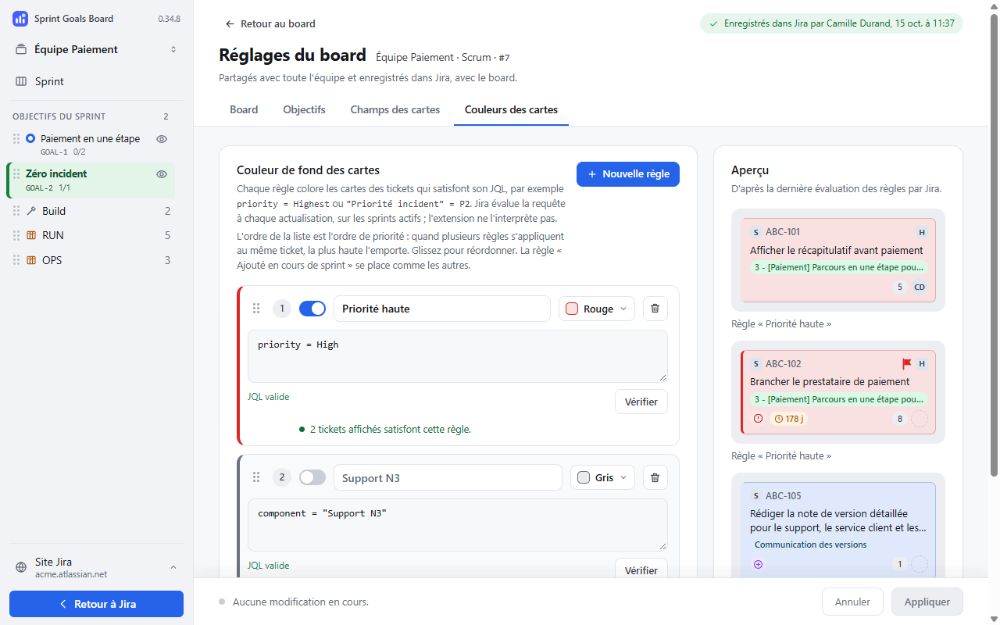
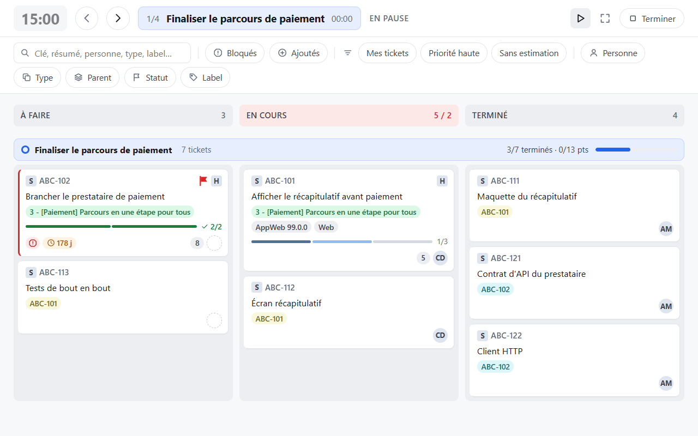

# Sprint Goals Board pour Jira — guide utilisateur

Huit fiches pour prendre en main votre board, organiser le travail par objectifs et retrouver
les bons réglages. Les captures montrent l'interface avec des données fictives.
Les instructions utilisent les libellés français ; des versions en [anglais](user-guide.en.md)
et en [espagnol](user-guide.es.md) sont également disponibles. Les captures du board restent
en français dans les trois versions.

## Installer l'extension

Sprint Goals Board ajoute une vue par objectifs à vos boards **Scrum et Kanban dans Jira Cloud**.
Il fonctionne dans Chrome, sur les sites `*.atlassian.net`, avec votre compte Jira habituel.
Vous devez pouvoir consulter le board dans Jira ; être administrateur n'est pas nécessaire
pour l'afficher dans l'extension.

### Ajouter Sprint Goals à Chrome

1. Ouvrez la [fiche officielle sur le Chrome Web Store](https://chromewebstore.google.com/detail/sprint-goals-board-pour-j/pepbknjnielcbfcoefcdmadmomapicgp?hl=fr).
2. Cliquez sur **Ajouter à Google Chrome**, puis confirmez avec **Ajouter l'extension**.
3. Ouvrez le menu **Extensions**, l'icône puzzle de Chrome, et épinglez **Sprint Goals Board pour Jira**.
4. Dans l'onglet de bienvenue, passez à [Connecter votre Jira](#connecter-votre-jira).

### La retrouver et la mettre à jour

L'icône épinglée permet de rouvrir Sprint Goals depuis Chrome. Sur un board Jira autorisé,
vous pouvez aussi utiliser le bouton **Sprint Goals** présent dans la page.

Chrome gère les mises à jour. Après une mise à jour, rechargez vos onglets Jira pour profiter
de la version installée. Sur un poste d'entreprise, l'installation peut nécessiter
l'autorisation de votre service informatique.

## Connecter votre Jira

L'extension utilise votre session Jira ouverte dans Chrome. **Elle ne vous demande ni mot de
passe ni jeton.** L'autorisation porte sur le site que vous choisissez.

### Autoriser le premier site

1. Dans l'onglet **Sprint Goals est installé**, repérez **Adresse de votre Jira ou d'un board**.
2. Saisissez `https://votre-equipe.atlassian.net`, ou collez l'adresse complète d'un board.
3. Cliquez sur **Autoriser et ouvrir Jira**, puis acceptez l'accès demandé par Chrome.
4. Connectez-vous à Jira si nécessaire. Avec l'adresse du site, choisissez ensuite votre board ;
   avec une adresse de board reconnue, sa vue Sprint Goals s'ouvre directement.

L'onglet de bienvenue est fermé ? Cliquez sur l'icône Chrome de l'extension : le formulaire
**Sprint Goals dans Jira** propose **Ouvrir dans Jira**. Vous pouvez également y réessayer
après un refus d'autorisation.

### Vos accès restent ceux de Jira

Aucun réglage initial n'est obligatoire : colonnes, statuts et réglages partagés sont lus
automatiquement. L'extension ne donne pas de droits supplémentaires sur les tickets.

Pour connecter un autre site, ouvrez l'un de ses boards dans Jira, puis utilisez l'icône Chrome
et autorisez ce site. La vue intégrée reste liée au site de la page qui l'héberge.

## Ajouter un board

Ajouter un board signifie **ouvrir et mémoriser un board Jira existant**. Cette action ne crée
pas de board et ne change pas sa configuration dans Jira.

### Depuis votre board Jira

1. Ouvrez le board Scrum ou Kanban souhaité dans Jira.
2. Si le site est autorisé, cliquez sur **Sprint Goals** dans la page : le chargement démarre.
3. Sinon, utilisez l'icône Chrome. Après **Board Jira reconnu dans cet onglet.**, cliquez sur
   **Ouvrir dans Jira** et acceptez l'autorisation.

Le clic sur l'icône Chrome ouvre directement la vue lorsque le board est reconnu et le site
déjà autorisé.

Dans Jira, le bouton compact affiche l'icône Sprint Goals ; son infobulle indique son nom.
Déplacez-le avec sa poignée gauche, par exemple dans un espace libre de l'en-tête : il peut
s'approcher à 4 px des bords. Sa position est conservée pour ce site dans ce profil Chrome.
Au clavier, placez le focus sur la poignée puis utilisez les flèches, avec **Maj** pour affiner.
**Échap** annule un glissement.

### Depuis Sprint Goals

1. Cliquez sur le **nom du board**, en haut à gauche, puis **Ajouter un board…**.
2. Dans **Quel board afficher ?**, saisissez tout ou partie du **Nom du board**.
3. Choisissez le résultat voulu, puis attendez **Lecture du board…**.

La recherche concerne les boards accessibles du même site. Elle affiche cinq résultats maximum :
précisez le nom si nécessaire. Les flèches puis **Entrée** permettent aussi de sélectionner.
**Annuler** revient au board précédent.

### Retrouver vos boards

Le menu du nom du board permet de basculer entre vos boards enregistrés. **Retirer « … » de
l'extension…** efface ses réglages locaux après confirmation, sans supprimer le board ni ses
réglages partagés dans Jira.

## Utiliser le board

### Lire et filtrer

Les lignes répartissent les tickets entre **objectifs**, **Build** et groupes par type comme
RUN. Les colonnes et leurs statuts viennent de Jira. Cliquez sur une ligne dans la barre
latérale pour la rejoindre.

Utilisez **Rechercher**, puis les filtres **Personne**, **Type**, **Parent**, **Statut** ou **Label**.
Les filtres rapides viennent de Jira. **Réinitialiser (N)** retire
les filtres ; **Actualiser** relit les données.

Avec plusieurs sprints actifs, le board réunit leurs tickets et les objectifs des sprints du board,
chacun préfixé du nom de son sprint. Un sprint d'un autre board, remonté par un ticket partagé,
apparaît en couleur dans l'en-tête. Le filtre **Sprint** ne garde que les tickets d'un sprint ; tous
les objectifs restent affichés.

### Ouvrir et déplacer les tickets

- Cliquez sur une carte pour ouvrir sa fiche native Jira. Sa fermeture actualise le board.
- Glissez une carte dans une colonne pour changer son statut. Plusieurs statuts dans une colonne ?
  Déposez-la dans la zone du statut voulu.
- Glissez-la vers un objectif pour l'y rattacher, ou vers sa ligne par défaut pour la détacher.
- Déplacez-la à la position voulue lorsque Jira autorise le changement de rang.

Si Jira ouvre un formulaire de transition, complétez-le et validez-le vous-même. Après une erreur,
lisez le résultat et vérifiez le board actualisé avant de recommencer.

### Retrouver Jira

**Retour à Jira** est en bas de la barre latérale. Il disparaît lorsqu'elle est repliée ;
réaffichez-la avec **Afficher la barre latérale** pour le retrouver.
Le bouton **Sprint Goals** dans Jira se déplace par sa poignée ; sa position est mémorisée.

Les sous-tâches s'affichent selon le périmètre et les statuts du board ; certaines peuvent manquer.

## Organiser les objectifs

### Choisir leur source

Ouvrez **nom du board → Réglages de ce board → Objectifs**.

- **Scrum, Texte du sprint** : renseignez dans Jira le champ **Objectif** du sprint, avec une ligne
  par objectif. Actualisez Sprint Goals, puis rattachez les tickets par glisser-déposer.
  Pour renommer ou ajouter un objectif, modifiez ce texte dans Jira.
- **Goals Atlassian** : utilisez les Goals existants liés aux tickets. Cette source est proposée
  en Scrum et utilisée en Kanban. Créez les Goals manquants dans Atlassian.

### Donner la priorité à l'objectif

Un ticket rattaché apparaît dans son **objectif visible**, même si son type appartient à RUN.
Sans objectif visible, il rejoint la ligne prévue pour son type : Build ou une swimlane dédiée.
Déplacer un ticket entre objectifs ne change pas son type Jira.

Build et les groupes par type disparaissent lorsqu'ils sont vides. Un objectif non vide devient
vert quand tous ses tickets sont dans la dernière colonne visible, sans modifier le Goal Atlassian.

### Garder ou masquer un Goal

Dans **Épingler un Goal du site**, recherchez par **Nom, clé ou responsable**, sélectionnez
les Goals et cliquez sur **Enregistrer dans Jira** pour conserver leurs lignes même vides.
En Scrum avec plusieurs sprints actifs du board, choisissez d'abord le **Sprint de l'épinglage**
(le premier sprint est proposé) : l'épinglage ne vaut que pour ce sprint. Le choix reste bloqué tant
qu'une sélection n'est ni enregistrée ni annulée.

Masquer un objectif conserve ses liens et renvoie ses tickets vers leur ligne par défaut.
La rubrique **Masqués du board** permet de le réafficher.

## Configurer le board

Ouvrez **nom du board → Réglages de ce board**. Les réglages partagés demandent les droits Jira
correspondants. **Retour au board** vous ramène aux tickets.

### Choisir la langue de l'interface

Dans la barre latérale, ouvrez **Site Jira → Préférences personnelles**, puis **Langue de
l'interface**. Le même choix figure dans les réglages du board, dans un encart **Personnel**.
Il est accessible sans droit d'administration Jira.

- **Automatique — suivre Jira**, le choix initial : français si votre Jira est en français,
  espagnol si votre Jira est en espagnol, anglais pour toutes les autres langues. Si aucune langue Jira ne peut être déterminée,
  l'extension utilise l'anglais.
- **Français** : conserve l'interface en français, quelle que soit la langue Jira.
- **English** : conserve l'interface en anglais, quelle que soit la langue Jira.
- **Español** : conserve l'interface en espagnol, quelle que soit la langue Jira.

Le changement s'applique immédiatement, sans recharger le board ni effacer les champs en cours
de saisie. Le choix reste dans ce navigateur pour tous vos boards ; il n'est ni partagé avec
l'équipe ni enregistré dans Jira. Sélectionnez **Automatique — suivre Jira** pour revenir au
comportement initial.

Les titres de tickets, Goals, statuts et noms de swimlanes personnalisés ne sont pas traduits.
Les fiches de tickets et formulaires de transition natifs gardent la langue de Jira.

### Organiser les swimlanes

Dans **Board → Swimlanes**, **Default** désigne la ligne par défaut, initialement Build.
Cliquez sur **Nouvelle swimlane**, nommez-la RUN, puis ajoutez un premier type pour la créer.
Déplacez les types par glisser-déposer ou avec **Déplacer vers…** ; réordonnez les lignes par
leur poignée. **Affichée** contrôle leur visibilité. **Ignorés** exclut les types du board,
même rattachés à un objectif.

Ces changements s'enregistrent au fil des gestes ; sortir d'un champ valide son nom.
Les colonnes se règlent dans Jira : utilisez ensuite **Relire colonnes et types depuis Jira**.

### Personnaliser les cartes

Dans **Champs des cartes**, choisissez jusqu'à trois champs supplémentaires, ordonnez-les,
puis cliquez sur **Appliquer**.

Dans **Couleurs des cartes**, cliquez sur **Nouvelle règle**. Nommez-la, saisissez sa JQL avec les
suggestions, puis attendez **JQL valide** ou cliquez sur **Vérifier**. Choisissez couleur et ordre,
puis **Appliquer**. La première règle active qui correspond l'emporte ; l'aperçu reflète les
règles enregistrées, après évaluation. Les JQL servent aux couleurs, pas aux swimlanes.

**Appliquez avant de changer d'onglet** : les brouillons des champs et des couleurs ne sont pas conservés.

## Animer la Daily

### Parcourir le travail en équipe

1. Préparez vos filtres : ils restent actifs pendant la réunion.
2. Cliquez sur **Daily**, à droite de l'en-tête.
3. Parcourez les lignes avec **Swimlane précédente** et **Swimlane suivante**, ou les flèches **← / →**.
4. Utilisez **Mettre le minuteur en pause** ou **Reprendre le minuteur** selon le rythme de la discussion.
5. Cliquez sur **Terminer** pour revenir au board.

La Daily fonctionne en Scrum et en Kanban. Elle parcourt les lignes contenant des tickets visibles ;
les objectifs vides sont sautés. Les cartes restent consultables et déplaçables. Dans la première
colonne, **+ N autres** révèle les cartes supplémentaires et **Afficher moins** les replie.

### Ajuster la présentation

La durée se règle dans **Réglages de ce board → Board → Affichage et daily**. Le minuteur est
global ; un autre indicateur montre le temps passé sur la ligne.

Chrome peut ouvrir le plein écran. **Échap** quitte d'abord ce plein écran sans terminer la Daily.
Un rechargement de la page arrête la session.

Pour présenter le board sans parcours guidé, utilisez **Mode présentation**, puis **Quitter**
pour revenir à la vue normale. Quittez ce mode avant d'utiliser **Retour à Jira**.

## Trouver de l'aide

### Vérifier les points courants

- **Bouton absent** : ouvrez un board Jira, cliquez sur l'icône Chrome, autorisez le site si nécessaire,
  puis rechargez la page.
- **Board introuvable** : précisez son nom et vérifiez votre accès dans Jira et le site connecté.
- **Ticket manquant** : réinitialisez les filtres, puis vérifiez périmètre, statut, types ignorés et
  lignes masquées. Pour une sous-tâche, vérifiez aussi son parent.
- **Objectif manquant** : contrôlez sa source, ses liens, son épinglage et **Masqués du board**.
- **Session expirée** : reconnectez-vous à Jira dans le même navigateur, puis réessayez.

### Préparer un retour utile

1. Ouvrez **Site Jira → Diagnostic**, en bas de la barre latérale.
2. Les lectures démarrent automatiquement ; **Relancer** les refait.
3. Dans **3 · Rapport**, utilisez **Copier le rapport**.

Relisez le rapport avant de le transmettre : il peut contenir des messages Jira. Ajoutez la version
de l'extension, l'action, le résultat attendu et, pour une lenteur, une durée approximative.

### Déconnecter l'extension

**Site Jira → Se déconnecter** retire l'autorisation du site et efface ses données locales après
confirmation. Les données Jira et votre session restent intactes. Pour revenir, autorisez de nouveau
le site et ajoutez vos boards.

Consultez la [politique de confidentialité](privacy/index.html) pour connaître les données utilisées.
