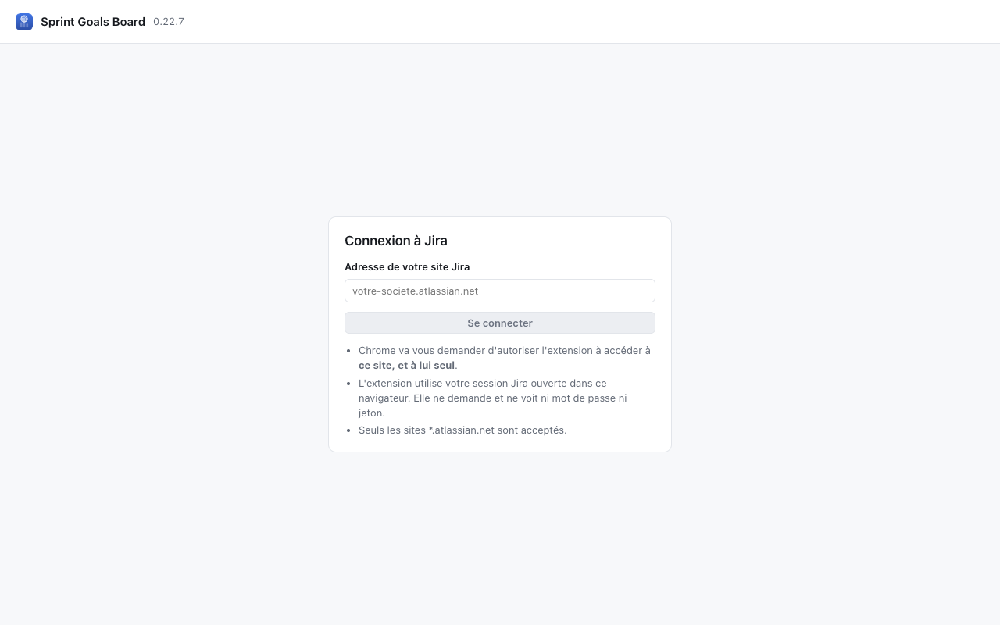
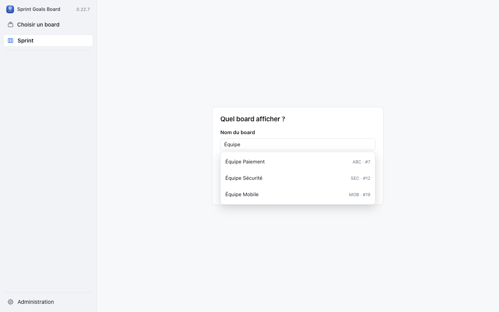

# Sprint Goals Board pour Jira — manuel d'installation et d'utilisation

> Extension Chrome qui affiche le sprint actif de votre board Scrum Jira Cloud en swimlanes, une
> par Sprint Goal. Version couverte par ce manuel : **0.22.7**.

Ce document est prêt à coller dans une page Confluence (titres, listes et texte en gras se
convertissent automatiquement à l'insertion). Les images pointent vers `docs/store/captures/` du
dépôt : consulté sur GitHub, ce fichier les affiche directement. Dans Confluence, le collage ne
récupère pas les images distantes : téléversez les 7 captures fournies séparément
(`01-board.png` à `07-recherche-board.png`) et remplacez chaque image collée par la vôtre au même
endroit. Ajoutez aussi le lien de téléchargement du fichier `.zip` en haut de la page, avant la
section Installation.

---

## 1. Installation

L'extension n'est pas publiée sur le Chrome Web Store : elle s'installe **en mode développeur**,
à partir du fichier `.zip` fourni sur cette page.

### 1.1 Activer le mode développeur de Chrome

1. Ouvrez `chrome://extensions` dans la barre d'adresse (ou menu Chrome → Plus d'outils →
   Extensions).
2. En haut à droite de la page, activez l'interrupteur **Mode développeur**.
3. Trois nouveaux boutons apparaissent en haut de la page : « Charger l'extension non
   empaquetée », « Empaqueter l'extension » et « Mettre à jour ».

### 1.2 Installer l'extension

1. Téléchargez le fichier `sprint-goals-board-<version>.zip` depuis le lien en haut de cette page.
2. **Décompressez-le** dans un dossier que vous garderez (par exemple `~/Applications/sprint-goals-board/`) :
   Chrome charge un dossier, pas une archive.
3. Retournez sur `chrome://extensions`, cliquez sur **Charger l'extension non empaquetée**, puis
   sélectionnez le dossier décompressé.
4. L'extension apparaît dans la liste, avec son icône. Épinglez-la dans la barre d'outils
   (icône puzzle en haut à droite de Chrome → épingle à côté de « Sprint Goals Board »).

### 1.3 Mettre à jour l'extension

Quand une nouvelle version est publiée sur cette page :

1. Téléchargez et décomprimez le nouveau `.zip` **dans le même dossier** (remplacez les anciens
   fichiers), ou dans un nouveau dossier si vous préférez garder l'ancien de côté.
2. Sur `chrome://extensions`, cliquez sur l'icône de rafraîchissement de la carte « Sprint Goals
   Board », ou sur **Mettre à jour** en haut de la page.

Vos réglages personnels (site connecté, board choisi, swimlanes repliées…) sont conservés d'une
version à l'autre tant que le dossier garde le même identifiant d'extension.

---

## 2. Premier lancement

1. Cliquez sur l'icône de l'extension dans la barre d'outils Chrome : un nouvel onglet s'ouvre sur
   l'écran de connexion.

2. Entrez l'adresse de votre site Jira Cloud (`https://votre-domaine.atlassian.net`). Chrome vous
   demande alors l'autorisation d'accéder à ce site : acceptez.
3. Recherchez votre board par son nom (boards **Scrum** uniquement ; les boards Kanban Jira ne
   sont pas pris en charge) et sélectionnez-le dans la liste proposée.

4. L'extension utilise la session de votre navigateur : si vous êtes déjà connecté à Jira dans
   Chrome, aucune saisie de mot de passe n'est demandée.

Pour ajouter un second board plus tard (menu du nom de board, dans la barre latérale, « Choisir un
board »), le même écran de recherche s'ouvre.

---

## 3. Le board

- **Barre latérale à gauche** : nom du board, entrée « Sprint », liste des **objectifs du
  sprint** (une ligne par Sprint Goal, avec sa progression en points), puis « Build » (tickets
  sans objectif) et la swimlane **Kanban** (support, anomalies de production…), nommée comme
  votre équipe le souhaite.
- **En-tête du sprint** : nom et dates du sprint, points terminés, nombre de Goals atteints,
  compteurs de tickets bloqués / ajoutés en cours de sprint / dans Build, heure de dernière
  synchronisation avec Jira, bouton **▶ Daily** (section 5) et bouton mode présentation (section 6).
- **Barre de filtres** : recherche libre, filtres à icônes (bloqués, ajoutés, mes tickets,
  priorité haute, sans estimation), menus Personne / Type / Parent / Statut / Label, et les
  filtres rapides définis dans votre board Jira.
- **Swimlanes** : une par objectif, dans l'ordre du board ; chaque swimlane affiche son nombre de
  tickets, sa progression et devient **verte** quand tous ses tickets sont dans la dernière colonne
  visible (objectif atteint). Un objectif épinglé au sprint peut avoir sa swimlane même sans
  ticket rattaché.
- **Glisser-déposer** : déplacer une carte change son statut (Jira ouvre le formulaire de
  transition — commentaire, temps passé, champs obligatoires — quand il le faut), son rang, ou son
  objectif si on la dépose dans une autre swimlane.
- **Sous-tâches** : rangées avec leur story ; un survol de la carte met en évidence toute sa
  famille (story + sous-tâches).

---

## 4. Réglages et objectifs du sprint (Administration)

Le bouton **Administration**, en bas de la barre latérale, ouvre les sections de réglages
directement sous ce bouton (le board reste affiché derrière).

- **Objectifs du sprint** : couleur et masquage de chaque swimlane (enregistrés aussitôt, pour
  toute l'équipe) ; si votre board utilise les **Goals Atlassian**, vous pouvez aussi épingler un
  Goal du site à ce sprint (il aura sa swimlane même sans ticket) — l'épinglage se confirme en
  cliquant sur « Enregistrer dans Jira ».
- **Board** : colonnes, types de tickets traités en Scrum ou en Kanban, durée de la Daily, stock
  Kanban affiché en Daily…
- **Champs des cartes** et **Couleurs des cartes** : quels champs Jira apparaissent sur une carte,
  et des règles de couleur en JQL évaluées par Jira.
- **Diagnostic** : informations techniques de connexion (utile en cas de souci, à fournir tel quel
  en cas de demande de support).

> Ces réglages sont **partagés avec toute l'équipe** (enregistrés dans une propriété de votre
> board Jira) : seules les personnes qui ont le droit de modifier le board dans Jira peuvent les
> changer. Sans ce droit, seul le Diagnostic reste accessible.

---

## 5. Mode Daily

Le bouton **▶ Daily** de l'en-tête lance une présentation dédiée à la mêlée quotidienne : plein
écran, une swimlane à la fois, dans l'ordre du board.

- **Minuteur** en haut à gauche : orange après 2 minutes, rouge avec le dépassement au-delà.
- **Précédent / Suivant** pour passer d'un objectif (ou de Build / Kanban) au suivant.
- La swimlane **Kanban** limite l'affichage aux premières cartes (dans l'ordre Jira) ; un bouton
  « + N autres » déplie le reste pour le temps de la Daily.
- Les tickets restent **glissables** pendant la Daily : les mises à jour se font en direct.
- Raccourcis clavier : flèches ← → pour naviguer, Espace pour mettre en pause, Échap pour
  quitter.
- Bouton **Terminer** en haut à droite pour sortir de la Daily à tout moment.

---

## 6. Mode présentation

Pour projeter le board (revue de sprint, écran partagé), utilisez le bouton en forme de chevalet
dans l'en-tête.

Ce mode passe en plein écran et agrandit le board, les filtres et les bandeaux pour une lecture à
distance ; barre latérale, en-tête et panneau de santé du sprint sont masqués. Un bouton
**Quitter** reste visible en bas de la barre de filtres, et l'appui sur Échap ramène à la vue
normale.

---

## 7. Bon à savoir

- **Rien n'est écrit dans Jira sans une action explicite de votre part** (glisser une carte,
  changer un réglage, épingler un Goal…) ; les changements ne s'affichent comme réussis qu'après
  confirmation de Jira.
- L'extension utilise **votre propre session Jira Cloud**, directement depuis votre navigateur :
  aucun serveur tiers, aucune mesure d'audience.
- Elle ne fonctionne qu'avec des boards **Scrum** sur **Jira Cloud** (`*.atlassian.net`).
- Le champ natif « Sprint Goal » du sprint Jira n'est jamais modifié par l'extension ; il est
  seulement lu si votre board utilise le mode « Texte du sprint » plutôt que les Goals Atlassian.

## 8. Support

En cas de problème, ouvrez la section **Diagnostic** de l'Administration et transmettez son
contenu tel quel à la personne qui maintient l'extension, avec une description de ce qui a été
tenté.
