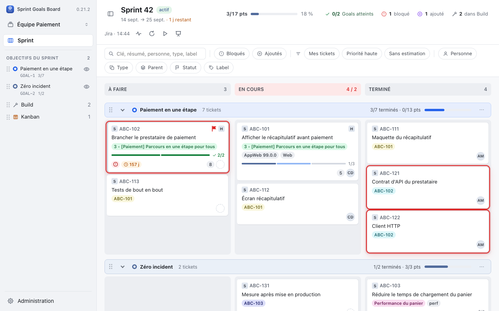
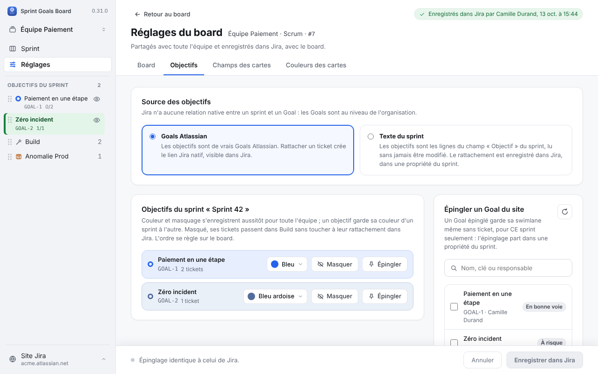
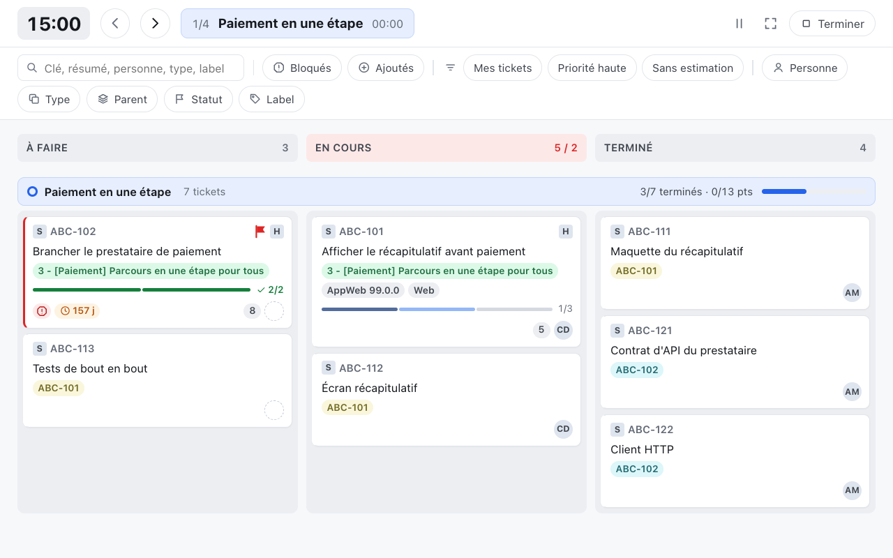
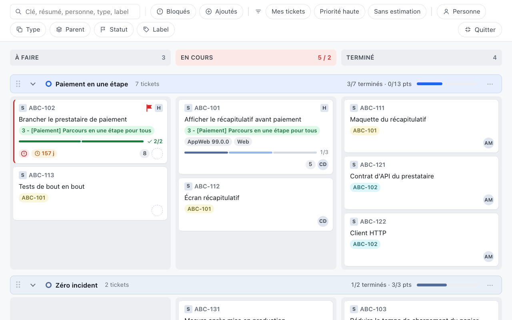

# Sprint Goals Board pour Jira — manuel d'installation et d'utilisation

> Extension Chrome pour boards Scrum et Kanban Jira Cloud : objectifs, Build et swimlanes par
> type configurables. Version couverte par ce manuel : **0.29.1**, intégré uniquement dans Jira. Les captures illustrent la
> version Scrum 0.22.7 ; certains libellés ont évolué.

Ce document est prêt à coller dans une page Confluence (titres, listes et texte en gras se
convertissent automatiquement à l'insertion). Les images pointent vers `docs/store/captures/` du
dépôt : consulté sur GitHub, ce fichier les affiche directement. Dans Confluence, le collage ne
récupère pas les images distantes : téléversez les 5 captures utilisées séparément
(`01-board.png` à `05-presentation.png`) et remplacez chaque image collée par la vôtre au même
endroit. Ajoutez aussi le lien de téléchargement du fichier `.zip` en haut de la page, avant la
section Installation.

---

## 1. Installation

L'extension n'est pas publiée sur le Chrome Web Store : elle s'installe **en mode développeur**,
à partir du fichier `.zip` fourni sur cette page.

### 1.1 Activer le mode développeur de Chrome

1. Ouvrez `chrome://extensions` dans la barre d'adresse (ou menu Chrome → Plus d'outils →
   Extensions).
2. En haut à droite de la page, activez l'interrupteur **Mode développeur**.
3. Trois nouveaux boutons apparaissent en haut de la page : « Charger l'extension non
   empaquetée », « Empaqueter l'extension » et « Mettre à jour ».

### 1.2 Installer l'extension

1. Téléchargez le fichier `sprint-goals-board-<version>.zip` depuis le lien en haut de cette page.
2. **Décompressez-le** dans un dossier que vous garderez (par exemple `~/Applications/sprint-goals-board/`) :
   Chrome charge un dossier, pas une archive.
3. Retournez sur `chrome://extensions`, cliquez sur **Charger l'extension non empaquetée**, puis
   sélectionnez le dossier décompressé.
4. L'extension apparaît dans la liste, avec son icône. Épinglez-la dans la barre d'outils
   (icône puzzle en haut à droite de Chrome → épingle à côté de « Sprint Goals Board »).

### 1.3 Mettre à jour l'extension

Quand une nouvelle version est publiée sur cette page :

1. Téléchargez et décomprimez le nouveau `.zip` **dans le même dossier** (remplacez les anciens
   fichiers), ou dans un nouveau dossier si vous préférez garder l'ancien de côté.
2. Sur `chrome://extensions`, cliquez sur l'icône de rafraîchissement de la carte « Sprint Goals
   Board », ou sur **Mettre à jour** en haut de la page.

Vos réglages personnels (site connecté, board choisi, swimlanes repliées…) sont conservés d'une
version à l'autre tant que le dossier garde le même identifiant d'extension.

---

## 2. Premier lancement

À l'installation, un onglet « Sprint Goals est installé » s'ouvre. Saisissez-y l'adresse de votre
Jira (par exemple `https://votre-domaine.atlassian.net`), cliquez « Autoriser et ouvrir Jira » et
acceptez la demande de Chrome : c'est tout. Si vous avez fermé cet onglet, procédez ainsi :

1. Connectez-vous à Jira dans Chrome et ouvrez votre board **Scrum ou Kanban**.
2. Cliquez sur l'icône de l'extension dans la barre d'outils Chrome. Le lanceur reconnaît le
   board de l'onglet : il n'y a rien à coller. Cliquez « Ouvrir dans Jira ».
3. Autorisez l'accès à ce seul site dans la demande de Chrome. L'extension ouvre la vraie page
   du board Jira, avec le paramètre `sprintGoals=1`, et y affiche Sprint Goals.
4. La session Jira du navigateur est utilisée ; l'extension ne demande ni mot de passe ni jeton.

Ensuite, sur chaque board de ce site, un bouton **Sprint Goals** apparaît en bas à droite de la
page Jira, à gauche du bouton Rovo : un clic ouvre la vue pour ce board, sans passer par l'icône. Le bouton « Précédent »
du navigateur ramène au board Jira habituel.

Vous pouvez déplacer ce bouton en tirant la **poignée à gauche**. Sa position est conservée pour
tous les boards de ce site dans votre navigateur. Il reste visible quand la fenêtre rétrécit.
Au clavier : Tab jusqu'à la poignée, puis les flèches (Maj pour déplacer plus finement).
Échap annule un glissement. La position reste locale à ce profil Chrome, sans cookie ni
synchronisation entre postes.

Pour refermer la vue et retrouver le board Jira habituel, cliquez **Retour à Jira**, le bouton
bleu en bas à droite de la vue.

Changer de board depuis le menu des boards de l'extension change aussi la page Jira : l'adresse
de l'onglet est toujours celle du board affiché.

Le lanceur ne charge aucun ticket. Il n'existe plus de vue du board dans un onglet autonome de
l'extension : l'URL Jira reste toujours derrière le board. Vous pouvez enregistrer cette URL
dans vos favoris. Sans `sprintGoals=1`, Jira conserve son affichage habituel.

Si vous êtes sur un board Jira déjà autorisé, l'icône l'ouvre directement dans Sprint Goals.
Sinon, le formulaire est prérempli avec le board mémorisé : vous pouvez garder son URL ou la
remplacer, puis cliquer sur « Ouvrir dans Jira ». Cela permet aussi de choisir un autre site.
Pour choisir un autre board du site courant depuis la vue intégrée, utilisez
le menu du nom du board dans la barre latérale ; sa sélection ouvre l'URL Jira correspondante.
Les anciennes captures de connexion et de recherche ne décrivent plus le premier lancement.

---

## 3. Le board

- **Barre latérale à gauche** : nom du board, vue Sprint en Scrum ou vue du board en Kanban,
  liste des objectifs, puis **Build** et les swimlanes par type configurées, par exemple RUN et OPS.
- **En-tête du sprint** : nom et dates du sprint, points terminés, nombre de Goals atteints,
  compteurs de tickets bloqués / ajoutés en cours de sprint / dans Build s'il contient des tickets, heure de dernière
  synchronisation avec Jira, bouton **▶ Daily** (section 5) et bouton mode présentation (section 6).
- **Barre de filtres** : recherche libre, filtres à icônes (bloqués, ajoutés, mes tickets,
  priorité haute, sans estimation), menus Personne / Type / Parent / Statut / Label, et les
  filtres rapides définis dans votre board Jira.
- **Swimlanes** : une par objectif, dans l'ordre du board ; chaque swimlane affiche son nombre de
  tickets, sa progression et devient **verte** quand tous ses tickets sont dans la dernière colonne
  visible (objectif atteint). Un objectif épinglé au sprint, ou au board Kanban, peut avoir sa swimlane même sans
  ticket rattaché. Build et les swimlanes par type sont masqués lorsqu'ils n'ont aucun ticket.
  Build vide apparaît le temps d'un glisser-déposer pour pouvoir y détacher un ticket.
- **Glisser-déposer** : déplacer une carte change son statut (Jira ouvre le formulaire de
  transition — commentaire, temps passé, champs obligatoires — quand il le faut), son rang, ou son
  objectif si on la dépose dans une autre swimlane d'objectif ou dans Build. Une carte classée
  dans une swimlane par type reste dans sa swimlane ; sa colonne et son rang peuvent changer.
- **Informations flottantes** : la croix ferme définitivement l'information de lecture partielle
  des Goals pour ce board. Ce choix est personnel et reste après rechargement.
- **Sous-tâches** : rangées avec leur story ; un survol de la carte met en évidence toute sa
  famille (story + sous-tâches).
- **Ouverture d'un ticket** : cliquer sur sa carte affiche la fiche native Jira dans une fenêtre
  superposée. La fermeture revient au board et relit les données.

---

### Boards Kanban

Le board fonctionne sans sprint : son en-tête affiche le nom du board, sans dates de sprint,
jours restants ni compteur ou filtre « ajouté en cours de sprint ». Les tickets correspondent
au filtre et au sous-filtre Kanban du board, dans les statuts de ses colonnes. Le backlog n'est
pas chargé séparément et les tickets terminés ne sont pas limités à un âge arbitraire.

Les objectifs viennent des **Goals Atlassian** des tickets et de ceux épinglés au board.
Le mode « Texte du sprint » n'est pas proposé. Si les Goals ne peuvent pas être lus, un message
signale l'échec de synchronisation ; les tickets ne sont pas reclassés à tort dans Build.
Si le lien GraphQL entre Goals et tickets n'est pas exposé par votre site, l'extension utilise
le champ Goals des tickets Jira. Si elle indique que ce champ n'a pas été identifié, choisissez
« Relire structure » dans l'administration du board.
Un message « chargement incomplet » peut demander de réduire le filtre du board : la lecture est
limitée à 5 000 tickets, et l'extension refuse d'afficher comme complet un résultat tronqué.

## 4. Réglages et objectifs (Administration)

Le bouton **Administration**, en bas de la barre latérale, ouvre les sections de réglages
directement sous ce bouton (le board reste affiché derrière).

- **Objectifs du sprint / Objectifs du board** : couleur et masquage de chaque swimlane (enregistrés aussitôt, pour
  toute l'équipe) ; si votre board utilise les **Goals Atlassian**, vous pouvez aussi épingler un
  Goal du site à ce sprint (il aura sa swimlane même sans ticket) — l'épinglage se confirme en
  cliquant sur « Enregistrer dans Jira ». En Kanban, le Goal est épinglé au board et partagé
  avec l'équipe ; il faut le droit de modifier le board.
- **Board** : colonnes communes, types de tickets et swimlanes, durée de la Daily et stock affiché.
  Chaque type va dans « Par objectif », une swimlane nommée ou « Ignorés ». « Nouvelle swimlane »
  crée un groupe ; retirer son dernier type le supprime. Le nom suit ceux des types tant que vous
  ne le personnalisez pas. Build est renommable ; chaque swimlane par type peut être masquée.
- **Champs des cartes** et **Couleurs des cartes** : quels champs Jira apparaissent sur une carte,
  et des règles de couleur en JQL évaluées par Jira.
- **Diagnostic** : informations techniques de connexion (utile en cas de souci, à fournir tel quel
  en cas de demande de support).

> Ces réglages sont **partagés avec toute l'équipe** (enregistrés dans une propriété de votre
> board Jira) : seules les personnes qui ont le droit de modifier le board dans Jira peuvent les
> changer. Sans ce droit, seul le Diagnostic reste accessible.

---

## 5. Mode Daily

Le bouton **▶ Daily** de l'en-tête lance une présentation dédiée à la mêlée quotidienne : plein
écran, une swimlane à la fois, dans l'ordre du board.

- **Minuteur** en haut à gauche : orange dans les 2 dernières minutes, puis rouge avec le dépassement.
- **Précédent / Suivant** pour passer d'un objectif, de Build ou d'une swimlane par type au suivant.
- La première colonne de **chaque swimlane** limite l'affichage aux premières cartes (3 par défaut,
  dans l'ordre Jira) ; « + N autres » déplie cette swimlane seule, « Afficher moins » la replie.
- Les tickets restent **glissables** pendant la Daily : les mises à jour se font en direct.
- Raccourcis clavier : flèches ← → pour naviguer, Espace pour mettre en pause, Échap pour
  quitter.
- Bouton **Terminer** en haut à droite pour sortir de la Daily à tout moment.

---

## 6. Mode présentation

Pour projeter le board (revue de sprint, écran partagé), utilisez le bouton en forme de chevalet
dans l'en-tête.

Ce mode passe en plein écran et agrandit le board, les filtres et les bandeaux pour une lecture à
distance ; barre latérale, en-tête et panneau de santé du sprint sont masqués. Un bouton
**Quitter** reste visible en bas de la barre de filtres, et l'appui sur Échap ramène à la vue
normale.

---

## 7. Bon à savoir

- **Rien n'est écrit dans Jira sans une action explicite de votre part** (glisser une carte,
  changer un réglage, épingler un Goal…) ; les changements ne s'affichent comme réussis qu'après
  confirmation de Jira.
- L'extension utilise **votre propre session Jira Cloud**, directement depuis votre navigateur :
  aucun serveur tiers, aucune mesure d'audience.
- Elle fonctionne avec des boards **Scrum et Kanban** sur **Jira Cloud** (`*.atlassian.net`).
- Le champ natif « Sprint Goal » du sprint Jira n'est jamais modifié par l'extension ; il est
  seulement lu si votre board utilise le mode « Texte du sprint » plutôt que les Goals Atlassian.

## 8. Support

### Comprendre un chargement lent

À l'ouverture, les types connus sont conservés et complétés par les tickets du sprint ou du
board Kanban. L'historique complet du board n'est plus parcouru uniquement pour recenser les
types. Pour découvrir aussi des types présents seulement dans le backlog ou d'anciens tickets,
utilisez **Relire colonnes et types depuis Jira** dans les réglages du board.

Un indicateur en bas à gauche montre le temps écoulé et l'étape en cours. Cliquez sur
**Voir les détails** pour ouvrir le diagnostic de chargement, même pendant l'attente.
La fenêtre se ferme avec sa croix, Échap ou un clic sur le fond ; la mesure continue.
Elle est masquée en Daily et en présentation.

La chronologie distingue la configuration, les tickets, les objectifs, les filtres et les
couleurs. Les trois temps affichés correspondent aux données prêtes, au board affiché et à la
fin de la synchronisation. Le temps d'affichage est une estimation après deux frames du
navigateur. La navigation de Jira avant le démarrage de l'extension n'est pas mesurée.
Les étapes qui se déroulent en parallèle ne doivent pas être additionnées.

Cliquez sur **Copier le rapport** et collez-le dans votre demande de support, en précisant
« ouverture lente » ou « actualisation lente ». Le rapport contient version, type de board,
comptages, durées et erreurs techniques, sans nom, URL, contenu des tickets ou identifiants
Jira. Il reste copiable si le chargement échoue ou est encore en cours. Aucun envoi automatique.

Les cinq derniers chargements restent dans ce navigateur pour les comparer. L'historique
peut être effacé depuis la fenêtre et disparaît aussi à la déconnexion. Si plusieurs
actions de relecture se chevauchent, elles peuvent prolonger une même mesure.
Pour comparer plusieurs essais, effectuez-les dans le même onglet : des onglets ouverts
simultanément peuvent remplacer leurs historiques respectifs.

### Connexion ou droits Jira

Ouvrez **Administration → Diagnostic**. Ce diagnostic distinct vérifie les capacités de
connexion et propose un rapport ; relisez-le avant de le transmettre avec la description du
problème.
