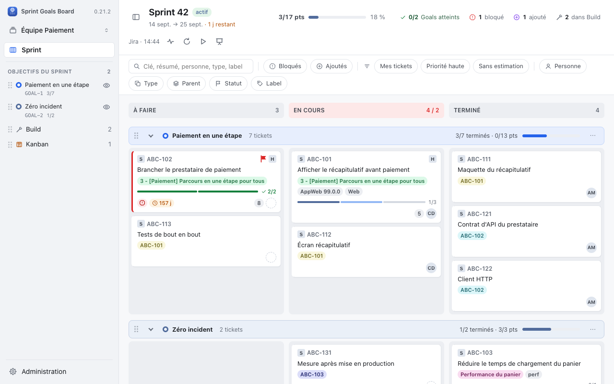
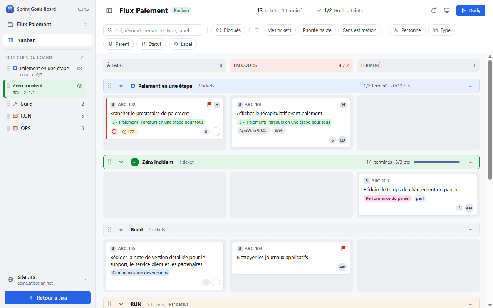
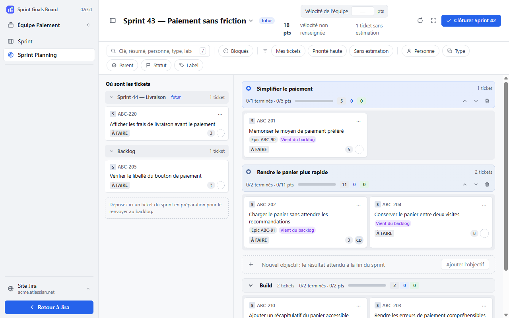
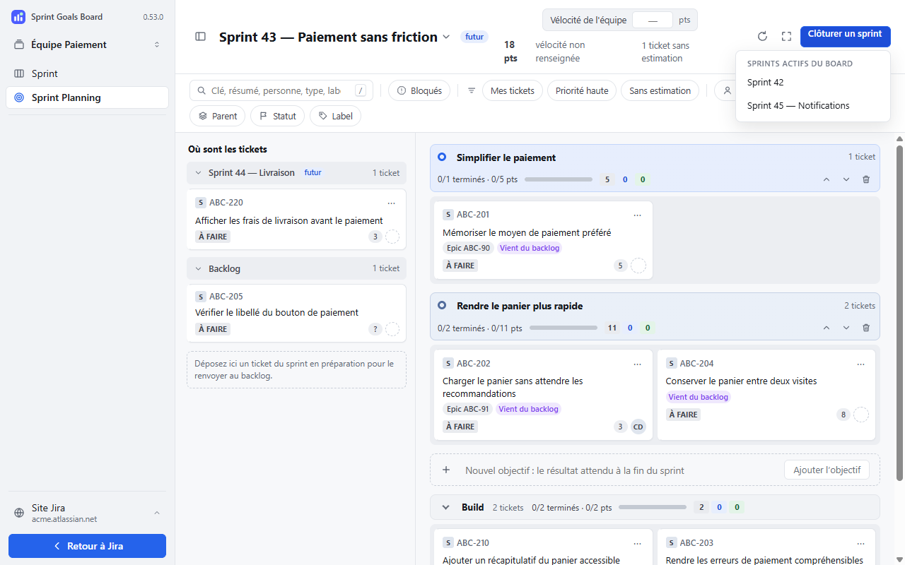
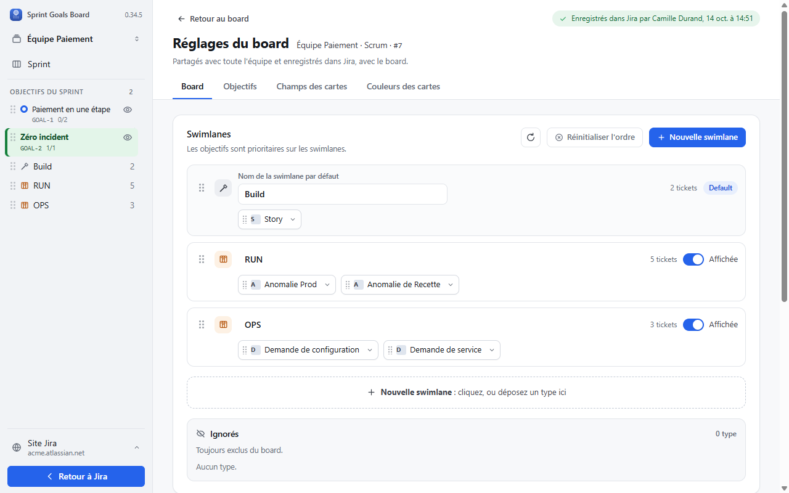
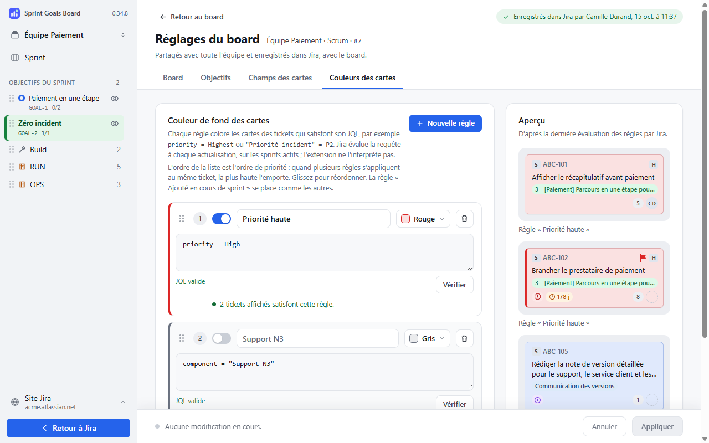
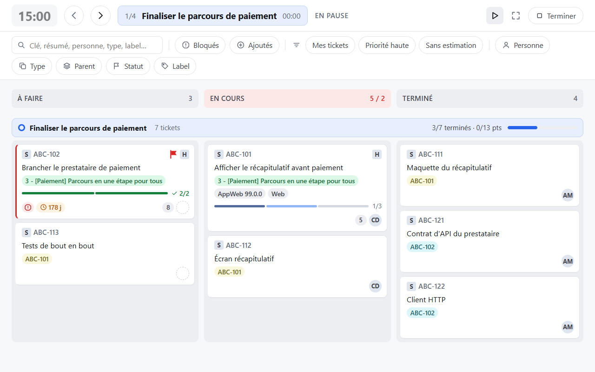

# Sprint Goals Board for Jira — user guide

Nine short guides to help you use your board, organize work around goals and find the right
settings. Screenshots use sample data. Instructions use the English interface labels; a
[French](manuel-utilisateur.md) and [Spanish](user-guide.es.md) versions of the guide are also
available. Board and planning screenshots remain in French in all three versions.

## Install the extension

Sprint Goals Board adds a goal-based view to your **Scrum and Kanban boards in Jira Cloud**.
It works in Chrome on `*.atlassian.net` sites, using your usual Jira account. You need access
to the board in Jira; administrator rights are not required to view it in the extension.

### Add Sprint Goals to Chrome

1. Open the [official Chrome Web Store listing](https://chromewebstore.google.com/detail/sprint-goals-board-pour-j/pepbknjnielcbfcoefcdmadmomapicgp?hl=en).
2. Select **Add to Chrome**, then confirm with **Add extension**.
3. Open Chrome's **Extensions** menu, the puzzle icon, and pin **Sprint Goals Board for Jira**.
4. In the welcome tab, continue with [Connect your Jira](#connect-your-jira).

### Find it again and stay up to date

The pinned icon lets you reopen Sprint Goals from Chrome. On an authorized Jira board,
you can also use the **Sprint Goals** button inside the page.

Chrome handles updates. After an update, reload your Jira tabs to use the installed version.
On a company computer, your IT team may need to approve the installation.

## Connect your Jira

The extension uses your existing Jira session in Chrome. **It never asks for a password or
API token.** Access permission applies to the site you choose.

### Authorize your first site

1. In the **Sprint Goals is installed** tab, find **Jira site or board address**.
2. Enter `https://your-team.atlassian.net`, or paste a board's full address.
3. Select **Allow access and open Jira**, then accept Chrome's permission request.
4. Sign in to Jira if needed. If you entered a site address, choose your board next.
   If you entered a recognized board address, its Sprint Goals view opens directly.

Closed the welcome tab? Click the extension's Chrome icon: the **Sprint Goals in Jira**
form offers **Open in Jira**. You can also try again here after declining permission.

### Your access stays the same as in Jira

No initial settings are required: columns, statuses and shared settings load automatically.
The extension does not grant additional permissions on issues.

To connect another site, open one of its boards in Jira, click the Chrome icon and authorize
that site. The embedded view stays connected to the site of the page that hosts it.

## Add a board

Adding a board means **opening and remembering an existing Jira board**. It does not create
a board or change its configuration in Jira.

### From your Jira board

1. Open the Scrum or Kanban board you want in Jira.
2. If the site is authorized, click **Sprint Goals** on the page to start loading.
3. Otherwise, click the Chrome icon. After **Jira board detected in this tab.**, select
   **Open in Jira** and accept the permission request.

Clicking the Chrome icon opens the view directly when the board is recognized and its site
is already authorized.

The compact button inside Jira displays the Sprint Goals icon; its tooltip shows its name.
Move it with the handle on its left, for example into free space in the header. It can sit
as close as 4 px from an edge. Its position is remembered for that site in your Chrome profile.
With the keyboard, focus the handle and use the arrow keys; hold **Shift** for smaller steps.
**Escape** cancels a drag.

### From Sprint Goals

1. Click the **board name** at the top left, then **Add a board…**.
2. In **Which board would you like to display?**, enter all or part of the **Board name**.
3. Choose a result and wait while **Loading board…** is displayed.

Search covers the boards you can access on the same site. It shows up to five results;
refine the name if necessary. You can also select with the arrow keys and **Enter**.
**Cancel** returns to the previous board.

### Return to your boards

The board-name menu lets you switch between saved boards. **Remove ‘…’ from the extension…**
clears its local settings after confirmation, without deleting the board or its shared
settings in Jira.

## Use the board

### Read and filter

Rows organize issues into **goals**, **Build** and groups by issue type, such as RUN.
Columns and their statuses come from Jira. Click a row in the sidebar to jump to it.

Use **Search**, then the **Person**, **Type**, **Parent**, **Status** or **Label** filters.
Quick filters come from Jira. **Reset (N)** clears the filters; **Refresh** reloads the data.

With several active sprints, the board combines their issues and the goals of the board's sprints,
each prefixed with its sprint name. A sprint from another board, brought in by a shared issue, is
shown in colour in the header. The **Sprint** filter keeps only one sprint's issues; every goal
stays visible.

### Open and move issues

- Click a card to open its native Jira issue dialog. Closing it refreshes the board. A middle
  click opens the issue in a new tab.
- Ctrl+click (Cmd+click on Mac) adds a card to the selection or removes it; Shift+click adds the
  cards between the last one chosen and this one, in the same column. The number of selected
  issues appears in the filter bar; Escape clears the selection.
- Drag a selected card: the whole selection goes with it, to a goal or a default row, dropped
  anywhere in the row. Only the issues' goal changes; they keep their column, status and rank. The
  menu of a selected card (right-click) also sends the whole batch to a goal; top and bottom
  priority are disabled there. At most 50 issues per gesture. A row that refuses an issue of the
  batch is unavailable. After a failure, the notice lists the confirmed issues and those to redo,
  which stay selected.
- Drag a card into a column to change its status. If the column has several statuses,
  drop it into the area for the status you want.
- Drag it to a goal to link it, or to its default row to unlink it: drop it anywhere in the
  row, header included. Only its goal changes; it keeps its column, status and rank. To change
  its status, drag it within its own row.
- Move it to the position you want when Jira allows rank changes.

If Jira opens a transition form, fill it in and submit it yourself. After an error, read
the result and check the refreshed board before trying again.

### Return to Jira

**Back to Jira** is at the bottom of the sidebar. It disappears when the sidebar is collapsed;
use **Show sidebar** to bring it back.
The **Sprint Goals** button in Jira can be moved with its handle; its position is remembered.

Subtasks appear according to the board's scope and statuses; some may be missing.

## Organize goals

### Choose their source

Open **board name → Board settings → Goals**.

- **Scrum, Sprint text**: in Jira, fill in the sprint's **Goal** field with one goal per line.
  Refresh Sprint Goals, then link issues by dragging and dropping them. To rename or add
  a goal, edit that text in Jira.
- **Atlassian Goals**: use existing Goals linked to issues. This source is available in
  Scrum and is used in Kanban. Create any missing Goals in Atlassian.

### Give the goal priority

A linked issue appears in its **visible goal**, even if its issue type belongs to RUN.
Without a visible goal, it goes to the row assigned to its type: Build or a dedicated swimlane.
Moving an issue between goals does not change its Jira issue type.

Build and groups by issue type disappear when empty. A non-empty goal turns green when all
its issues reach the last visible column; this does not change the Atlassian Goal.

### Keep or hide a Goal

Under **Pin a Goal from this site**, search by **Name, key or owner**, select the Goals and
click **Save to Jira** to keep their rows even when empty.

Hiding a goal preserves its links and returns its issues to their default row. Use
**Hidden from the board** to show it again.

## Prepare the sprint

**Sprint Planning** prepares the next sprint of a Scrum board: you choose its goals, place issues
from the backlog or from another future sprint, then complete the active sprint and start the next
one. Every action is written to Jira immediately, then Jira is read again: Jira stays the only
source, and the page is rebuilt each time you open it. Sprint Planning creates neither sprints nor
Atlassian Goals: create the future sprint in the Jira backlog, then refresh.

### Open the planning and choose the sprint

1. In the sidebar, click **Sprint Planning**. The view only exists on a Scrum board.
2. The page title is also the selector: click the sprint name and its small arrow to choose another
   **Sprint to prepare**. Only the future sprints you can edit are offered. Without any, the view
   asks you to create a sprint in the Jira backlog, or to ask an administrator for the **Manage
   sprints** permission.
3. **Refresh** reloads the issues from Jira. **Fullscreen** enlarges the view, like the Daily;
   **Escape** leaves it.

On the left, **Where the issues are** lists the backlog and the other future sprints of the board.
Like the Jira backlog, the list does not show issues in the last column. On the right, the sprint
being prepared: one row per goal, then **No goal**.

### Write the goals

- **Sprint text**: type a title in **New sprint goal**, then **Add goal**. You can rename a goal,
  move it up or down, or delete it; its issues then stay in the sprint, without a goal. Goals are
  written to the sprint's **Goal** field, one line each. If that text changes in Jira during the
  session, nothing is written: a notice appears, the page is read again and what you typed is kept.
- **Atlassian Goals**: **Search for a Goal to pin** by name, then **Pin**; **Unpin** leaves the Goal
  in Atlassian. Goals are created in Atlassian.

### Place the issues

- Drag a card onto a goal: an issue from the backlog or a future sprint joins the sprint and the
  goal; an issue already in the sprint changes goal. Drop it on **No goal** to detach it from its
  goal.
- A card's menu (right-click, or **⋯**) offers **Send to a goal**, **Add to the sprint**, **Remove
  from sprint** or **Send back to the backlog**, and **Move to top priority** or **Move to low
  priority** (top or bottom of its row in the sprint).
- An issue can only be removed from the sprint being prepared: drag it to the backlog or to another
  future sprint. Subtasks are read-only.
- **Ctrl/Cmd+click** adds or removes a card from the selection, **Shift+click** selects a range in the
  same section, **Escape** clears the selection. Drag one of the cards, or open its menu, to act on
  the whole selection (at most 50 issues per action).
- A single click opens the native Jira issue; a middle click opens it in a new tab.

### See the load and the progress

- **Team velocity** (in points) is shared with the team in the sprint data. It is written when you
  confirm the field (Enter or leaving it); **Escape** restores Jira's value. The sprint load, "x / y
  pts" and its percentage, is compared with this velocity; issues without an estimate are counted
  separately.
- Click the value on a card ("?" without an estimate) to **estimate** the issue in the board's
  estimation field: **Enter** confirms, **Escape** cancels, an unchanged value writes nothing. Without
  an estimation field, or in read-only mode, the native Jira issue remains the way to do it.
- A goal's header shows its finished issues and the board's grey / blue / green bar. What was already
  delivered before this sprint (a carried-over goal) is shown separately, hatched, and does not count
  in the load.
- **No goal** is arranged by issue-type swimlane (Build, RUN…), in the board's order, with the same
  header: the chevron collapses or expands its issues for the session, and each row shows its progress
  like a goal.
- Search (the **/** key) and the **Person**, **Type**, **Parent**, **Status**, **Label** and
  **Blocked** filters and the board's quick filters apply to the goals, to **No goal** and to the left
  column; totals and load stay computed without filters. **Added** and **Carried over** are not
  offered.

### Complete, then start the sprint

**Complete** and **Start** take turns. When the board has an active sprint, only **Complete
"sprint"** is offered and **Start** is hidden; with several active sprints, **Complete a sprint**
opens the list of their names. Without an active sprint, only **Start "sprint"** is offered.

1. Click **Complete** or **Start**: the extension opens Jira's native dialog. You fill it in and
   confirm it; the extension writes nothing in it.
2. After the dialog closes, the extension reads the sprint again for about ten seconds. If Jira did
   complete it, the unreached goals (at least one linked issue outside the last column) are carried
   over to the sprint being prepared, and a report per goal stays on screen until you close it. If the
   sprint is still active, nothing is written.
3. After the start dialog closes, the view reads Jira again.

### Permissions, refusals and uncertain results

Permissions are Jira's: **Manage sprints** for the sprints, and editing issues. An action that Jira
refuses is reported and the page is read again. Each write is attempted only once; if its result is
uncertain, the extension reads Jira again and does not announce success before confirming it.

## Configure the board

Open **board name → Board settings**. Shared settings require the corresponding Jira
permissions. **Back to board** takes you back to the issues.

### Choose your interface language

In the sidebar, open **Jira site → Personal preferences**, then **Interface language**.
The same choice appears in board settings in a **Personal** panel. It is available without
Jira administrator rights.

- **Automatic — follow Jira**, the initial choice: French when your Jira is in French,
  Spanish when your Jira is in Spanish, English for every other language. If the Jira language cannot be determined, the
  extension uses English.
- **Français**: keeps the interface in French, whatever the Jira language.
- **English**: keeps the interface in English, whatever the Jira language.
- **Español**: keeps the interface in Spanish, whatever the Jira language.

The change takes effect immediately, without reloading the board or clearing fields you
are editing. Your choice stays in this browser for all your boards; it is not shared with
your team or saved in Jira. Select **Automatic — follow Jira** to restore the initial behavior.

Issue titles, Goals, statuses and custom swimlane names are not translated. Native Jira
issue dialogs and transition forms keep Jira's own language.

### Organize swimlanes

In **Board → Swimlanes**, **Default** is the default row, initially named Build. Click
**New swimlane**, name it RUN, then add its first issue type to create it. Move issue types
by dragging them or using **Move to…**; reorder rows with their handles. **Visible** controls
their visibility. **Excluded** excludes issue types from the board, even when linked to a goal.

Changes are saved as you make them; leaving a name field saves that name. Configure columns
in Jira, then use **Reload columns and issue types from Jira**.

### Customize cards

In **Card fields**, choose up to three additional fields, put them in order, then click **Apply**.

In **Card colours**, click **New rule**. Give it a name, enter its JQL using the suggestions,
then wait for **Valid JQL** or click **Validate**. Choose a color and position, then **Apply**.
The first matching active rule wins; the preview reflects saved rules after evaluation.
JQL is used for colors, not swimlanes.

**Apply before switching tabs**: unsaved card-field and color changes are not kept.

## Run your Daily

### Review the work together

1. Set your filters: they stay active during the meeting.
2. Click **Daily** on the right of the header.
3. Move through rows with **Previous swimlane** and **Next swimlane**, or the **← / →** keys.
4. Use **Pause timer** or **Resume timer** to match the discussion's pace.
5. Click **Finish** to return to the board.

Daily works in Scrum and Kanban. It goes through rows containing visible issues and skips
empty goals. Cards can still be opened and moved. In the first column, **+ N more** reveals
additional cards and **Show less** collapses them again.

### Adjust the presentation

Set the duration in **Board settings → Board → Display and Daily**. The timer covers the
whole session; a separate indicator shows time spent on the current row.

Chrome may open full screen. **Escape** first exits full screen without ending the Daily.
Reloading the page stops the session.

To present the board without stepping through its rows, use **Presentation mode**, then
**Exit** to return to the normal view. Leave this mode before using **Back to Jira**.

## Get help

### Check common issues

- **Missing button**: open a Jira board, click the Chrome icon, authorize the site if needed,
  then reload the page.
- **Board not found**: refine its name and check your access in Jira and the connected site.
- **Missing issue**: reset filters, then check scope, status, ignored types and hidden rows.
  For a subtask, also check its parent.
- **Missing goal**: check its source, links, pinned state and **Hidden from the board**.
- **Expired session**: sign in to Jira again in the same browser, then retry.

### Prepare useful feedback

1. Open **Jira site → Diagnostics** at the bottom of the sidebar.
2. Read checks start automatically; **Run again** repeats them.
3. Under **3 · Report**, select **Copy report**.

Review the report before sharing it: it may contain Jira messages. Include the extension
version, your action, the expected result and, for slow loading, an approximate duration.

### Disconnect the extension

**Jira site → Sign out** removes the site's permission and clears its local data after
confirmation. Your Jira data and session remain intact. To return, authorize the site again
and add your boards.

See the [privacy policy](privacy/index.html) to learn which data is used.
