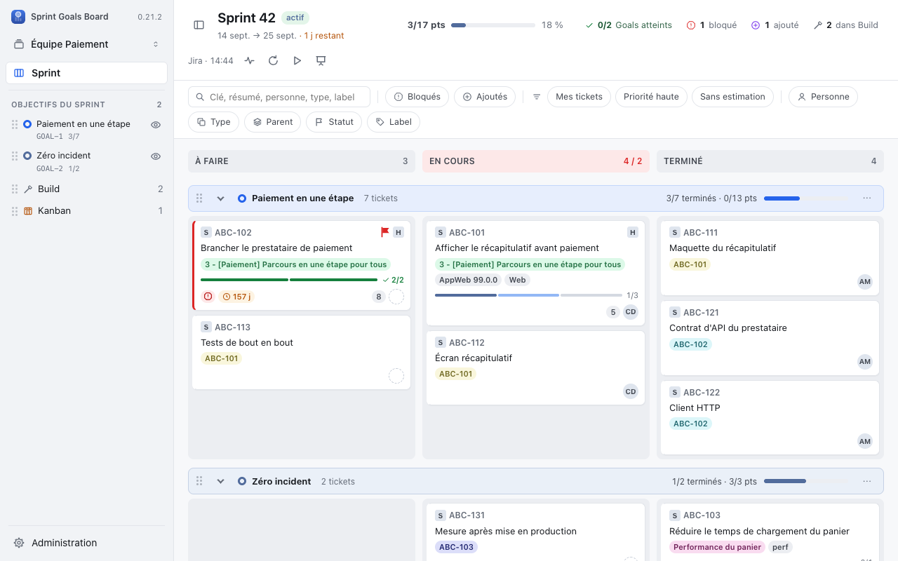
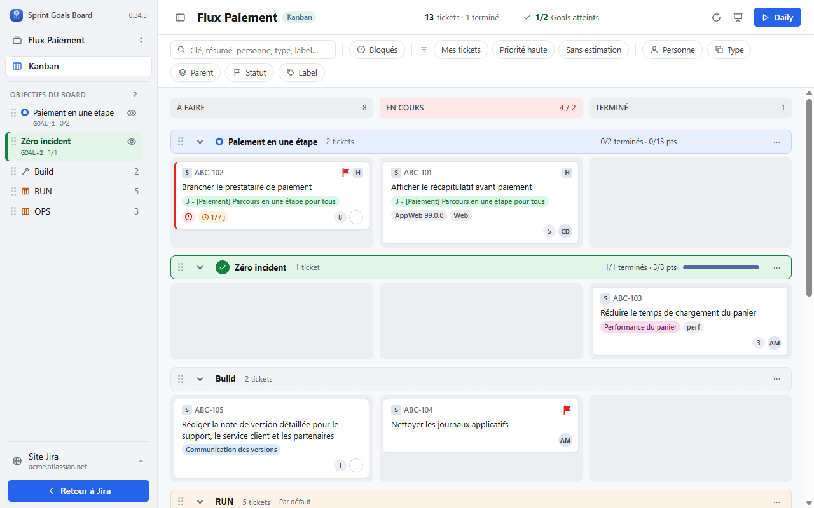
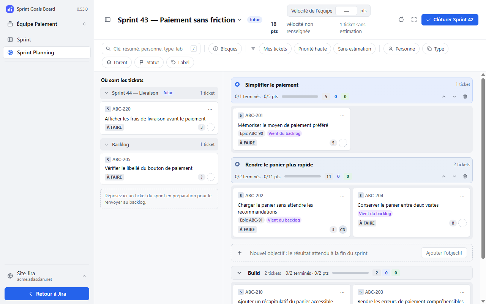
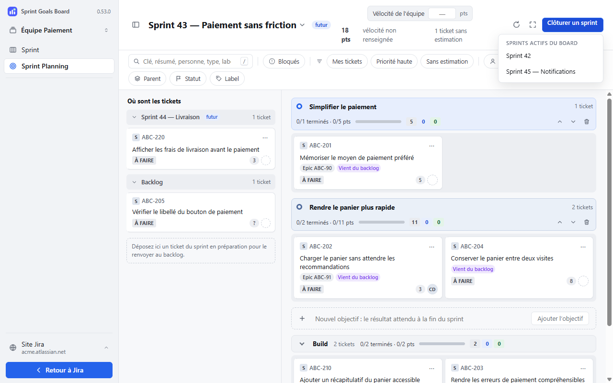
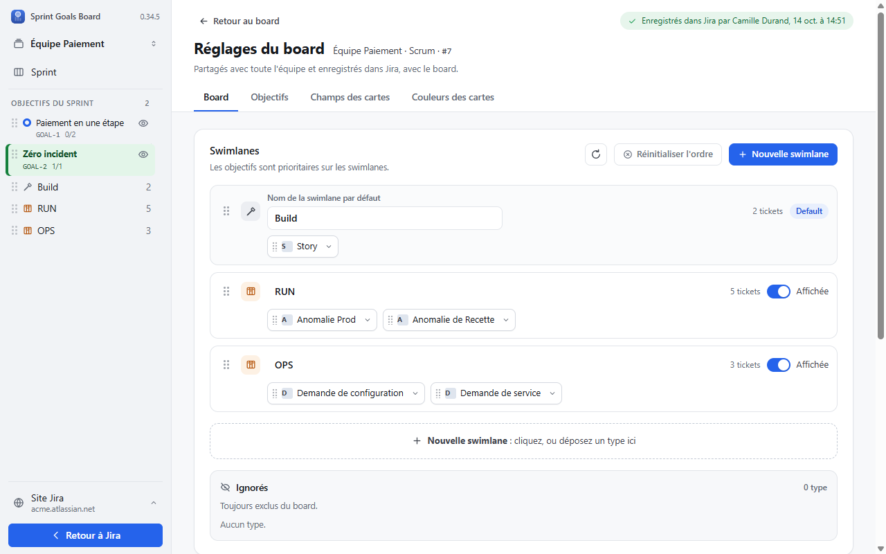
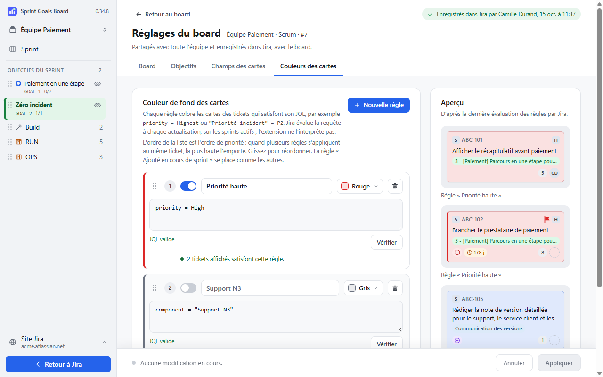
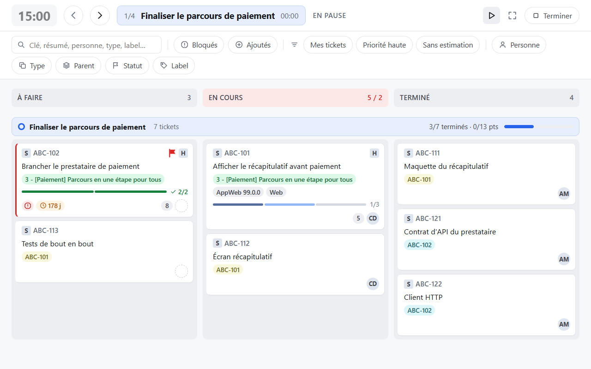

# Sprint Goals Board para Jira — guía de usuario

Nueve fichas sencillas para utilizar tu tablero, organizar el trabajo por objetivos y encontrar
los ajustes adecuados. Las capturas utilizan datos ficticios. Las instrucciones corresponden
a los textos de la interfaz en español; también hay versiones en
[francés](manuel-utilisateur.md) e [inglés](user-guide.en.md).
Las capturas del tablero y de la planificación se mantienen en francés en las tres versiones.

## Instalar la extensión

Sprint Goals Board añade una vista por objetivos a tus **tableros Scrum y Kanban de Jira Cloud**.
Funciona en Chrome, en sitios `*.atlassian.net`, con tu cuenta habitual de Jira. Necesitas acceso
al tablero en Jira; no hace falta ser administrador para consultarlo en la extensión.

### Añadir Sprint Goals a Chrome

1. Abre la [ficha oficial de Chrome Web Store](https://chromewebstore.google.com/detail/sprint-goals-board-pour-j/pepbknjnielcbfcoefcdmadmomapicgp?hl=es).
2. Selecciona **Añadir a Chrome** y confirma con **Añadir extensión**.
3. Abre el menú **Extensiones** de Chrome, el icono de puzle, y fija **Sprint Goals Board para Jira**.
4. En la pestaña de bienvenida, continúa con [Conectar tu Jira](#conectar-tu-jira).

### Volver a abrirla y mantenerla actualizada

El icono fijado permite abrir Sprint Goals desde Chrome. En un tablero de Jira autorizado,
también puedes utilizar el botón **Sprint Goals** de la página.

Chrome se encarga de las actualizaciones. Después de una actualización, recarga las pestañas
de Jira para utilizar la versión instalada. En un equipo de empresa, el departamento de
informática puede tener que autorizar la instalación.

## Conectar tu Jira

La extensión utiliza tu sesión de Jira abierta en Chrome. **Nunca pide una contraseña ni un
token de API.** El permiso de acceso se aplica al sitio que elijas.

### Autorizar tu primer sitio

1. En la pestaña **Sprint Goals está instalado**, busca **Dirección del sitio o tablero de Jira**.
2. Introduce `https://tu-equipo.atlassian.net` o pega la dirección completa de un tablero.
3. Selecciona **Permitir el acceso y abrir Jira** y acepta la solicitud de permiso de Chrome.
4. Inicia sesión en Jira si es necesario. Si has introducido la dirección de un sitio,
   elige después el tablero. Si has introducido una dirección de tablero reconocida,
   su vista de Sprint Goals se abre directamente.

¿Has cerrado la pestaña de bienvenida? Pulsa el icono de la extensión en Chrome: el formulario
**Sprint Goals en Jira** ofrece **Abrir en Jira**. También puedes volver a intentarlo aquí si
habías rechazado el permiso.

### Conservas los mismos permisos que en Jira

No hay ajustes iniciales obligatorios: las columnas, los estados y los ajustes compartidos
se cargan automáticamente. La extensión no concede permisos adicionales sobre las incidencias.

Para conectar otro sitio, abre uno de sus tableros en Jira, pulsa el icono de Chrome y autoriza
ese sitio. La vista integrada permanece conectada al sitio de la página que la contiene.

## Añadir un tablero

Añadir un tablero significa **abrir y recordar un tablero de Jira existente**. No crea un
tablero ni cambia su configuración en Jira.

### Desde tu tablero de Jira

1. Abre en Jira el tablero Scrum o Kanban que quieras utilizar.
2. Si el sitio está autorizado, pulsa **Sprint Goals** en la página para iniciar la carga.
3. Si no lo está, pulsa el icono de Chrome. Tras **Se ha detectado un tablero de Jira en esta pestaña.**,
   selecciona **Abrir en Jira** y acepta la solicitud de permiso.

El icono de Chrome abre directamente la vista cuando reconoce el tablero y su sitio ya está
autorizado.

El botón compacto dentro de Jira muestra el icono de Sprint Goals; su texto emergente indica
el nombre. Muévelo con el asa de la izquierda, por ejemplo a un hueco de la cabecera. Puede
quedar a solo 4 px de un borde. Su posición se recuerda para ese sitio en tu perfil de Chrome.
Con el teclado, enfoca el asa y utiliza las flechas; mantén **Mayús** para pasos más pequeños.
**Escape** cancela el arrastre.

### Desde Sprint Goals

1. Pulsa el **nombre del tablero**, arriba a la izquierda, y después **Añadir un tablero…**.
2. En **¿Qué tablero quieres mostrar?**, introduce parte o todo el **Nombre del tablero**.
3. Elige un resultado y espera mientras aparece **Cargando tablero…**.

La búsqueda incluye los tableros del mismo sitio a los que tienes acceso. Muestra hasta cinco
resultados; concreta el nombre si es necesario. También puedes elegir con las flechas y
**Intro**. **Cancelar** vuelve al tablero anterior.

### Volver a tus tableros

El menú del nombre permite cambiar entre los tableros guardados. **Quitar «…» de la extensión…**
borra sus ajustes locales después de confirmarlo, sin eliminar el tablero ni sus ajustes
compartidos en Jira.

## Utilizar el tablero

### Consultar y filtrar

Las filas organizan las incidencias en **objetivos**, **Build** y grupos por tipo, como RUN.
Las columnas y sus estados proceden de Jira. Pulsa una fila en la barra lateral para ir a ella.

Utiliza **Buscar** y los filtros **Persona**, **Tipo**, **Principal**, **Estado** o **Etiqueta**.
Los filtros rápidos proceden de Jira. **Restablecer (N)** elimina los filtros;
**Actualizar** vuelve a cargar los datos.

Con varios sprints activos, el tablero reúne sus incidencias y los objetivos de los sprints del
tablero, cada uno precedido del nombre de su sprint. Un sprint de otro tablero, aportado por una
incidencia compartida, aparece en color en el encabezado. El filtro **Sprint** solo conserva las
incidencias de un sprint; todos los objetivos siguen visibles.

### Abrir y mover incidencias

- Pulsa una tarjeta para abrir su ventana nativa de Jira. Al cerrarla se actualiza el tablero. Un
  clic con el botón central abre la incidencia en una pestaña nueva.
- Ctrl+clic (Cmd+clic en Mac) añade una tarjeta a la selección o la quita; Mayús+clic añade las
  tarjetas entre la última elegida y esta, en la misma columna. El número de incidencias
  seleccionadas aparece en la barra de filtros; Escape vacía la selección.
- Arrastra una tarjeta seleccionada: toda la selección se va con ella, a un objetivo o a una fila
  predeterminada, soltada en cualquier punto de la fila. Solo cambia el objetivo de las
  incidencias; conservan su columna, su estado y su orden. El menú de una tarjeta seleccionada (clic
  derecho) también envía todo el lote a un objetivo; la prioridad máxima y mínima están
  desactivadas. Como máximo 50 incidencias por gesto. Una fila que rechaza una incidencia del lote
  no está disponible. Tras un fallo, el aviso indica las incidencias confirmadas y las que hay que
  rehacer, que siguen seleccionadas.
- Arrastra una tarjeta a una columna para cambiar su estado. Si la columna contiene varios
  estados, suéltala en la zona del estado que quieras.
- Arrástrala a un objetivo para vincularla o a su fila predeterminada para desvincularla:
  suéltala en cualquier punto de la fila, encabezado incluido. Solo cambia su objetivo; conserva
  su columna, su estado y su orden. Para cambiar su estado, arrástrala dentro de su propia fila.
- Colócala en la posición que quieras cuando Jira permita cambiar su orden.

Si Jira abre un formulario de transición, rellénalo y envíalo tú mismo. Si se produce un error,
lee el resultado y comprueba el tablero actualizado antes de volver a intentarlo.

### Volver a Jira

**Volver a Jira** está en la parte inferior de la barra lateral. Desaparece cuando la barra
está oculta; utiliza **Mostrar barra lateral** para recuperarlo.
El botón **Sprint Goals** de Jira se puede mover con su asa; su posición queda guardada.

Las subtareas aparecen según el alcance y los estados del tablero; algunas pueden no aparecer.

## Organizar los objetivos

### Elegir su origen

Abre **nombre del tablero → Ajustes del tablero → Objetivos**.

- **Scrum, Texto del sprint**: en Jira, rellena el campo **Objetivo** del sprint con un
  objetivo por línea. Actualiza Sprint Goals y vincula las incidencias arrastrándolas.
  Para añadir un objetivo o cambiar su nombre, modifica ese texto en Jira.
- **Atlassian Goals**: utiliza Goals existentes vinculados a las incidencias. Este origen
  está disponible en Scrum y se utiliza en Kanban. Crea en Atlassian los Goals que falten.

### Dar prioridad al objetivo

Una incidencia vinculada aparece en su **objetivo visible**, aunque su tipo pertenezca a RUN.
Sin un objetivo visible, va a la fila asignada a su tipo: Build o un carril específico.
Mover una incidencia entre objetivos no cambia su tipo en Jira.

Build y los grupos por tipo desaparecen cuando están vacíos. Un objetivo con incidencias
se vuelve verde cuando todas llegan a la última columna visible; esto no modifica el Goal
de Atlassian.

### Mantener u ocultar un Goal

En **Fijar un Goal de este sitio**, busca por **Nombre, clave o responsable**, selecciona
los Goals y pulsa **Guardar en Jira** para mantener sus filas aunque estén vacías.

Ocultar un objetivo conserva sus vínculos y devuelve las incidencias a su fila predeterminada.
Utiliza **Ocultos en el tablero** para volver a mostrarlo.

## Preparar el sprint

**Sprint Planning** prepara el próximo sprint de un tablero Scrum: eliges sus objetivos, colocas
incidencias del backlog o de otro sprint futuro y, después, cierras el sprint activo e inicias el
siguiente. Cada gesto se escribe de inmediato en Jira y luego se vuelve a leer Jira: Jira sigue siendo
la única fuente y la página se reconstruye cada vez que la abres. Sprint Planning no crea sprints ni
Goals de Atlassian: crea el sprint futuro en el backlog de Jira y actualiza.

### Abrir la planificación y elegir el sprint

1. En la barra lateral, haz clic en **Sprint Planning**. La vista solo existe en un tablero Scrum.
2. El título de la página es también el selector: haz clic en el nombre del sprint y en su pequeña
   flecha para elegir otro **Sprint por preparar**. Solo se ofrecen los sprints futuros que puedes
   modificar. Sin ellos, la vista te pide crear un sprint en el backlog de Jira o pedir a un
   administrador el permiso **Gestionar sprints**.
3. **Actualizar** vuelve a cargar las incidencias desde Jira. **Pantalla completa** amplía la vista,
   como la Daily; **Escape** sale de ella.

A la izquierda, **Dónde están las incidencias** muestra el backlog y los demás sprints futuros del
tablero. Como el backlog de Jira, la lista no muestra las incidencias de la última columna. A la
derecha, el sprint en preparación: una fila por objetivo y después **Sin objetivo**.

### Escribir los objetivos

- **Texto del sprint**: escribe un título en **Nuevo objetivo del sprint** y haz clic en **Añadir el
  objetivo**. Puedes renombrar un objetivo, subirlo, bajarlo o eliminarlo; sus incidencias siguen en
  el sprint, sin objetivo. Los objetivos se escriben en el campo **Objetivo** del sprint, una línea
  cada uno. Si ese texto cambia en Jira durante la sesión, no se escribe nada: aparece un aviso, la
  página se vuelve a leer y se conserva lo que habías escrito.
- **Goals de Atlassian**: **Buscar un Goal para fijar** por su nombre y después **Fijar**; **Dejar de
  fijar** deja el Goal en Atlassian. Los Goals se crean en Atlassian.

### Colocar las incidencias

- Arrastra una tarjeta sobre un objetivo: una incidencia del backlog o de un sprint futuro se une al
  sprint y al objetivo; una incidencia del sprint cambia de objetivo. Suéltala en **Sin objetivo**
  para separarla de su objetivo.
- El menú de una tarjeta (clic derecho o **⋯**) ofrece **Enviar a un objetivo**, **Añadir al
  sprint**, **Quitar del sprint** o **Devolver al backlog**, y **Poner en prioridad máxima** o
  **Poner en prioridad baja** (principio o final de su fila en el sprint).
- Una incidencia solo se quita del sprint en preparación: arrástrala al backlog o a otro sprint
  futuro. Las subtareas son de solo lectura.
- **Ctrl/Cmd+clic** añade o quita una tarjeta de la selección, **Mayús+clic** selecciona un rango de
  la misma sección y **Escape** vacía la selección. Arrastra una de las tarjetas, o abre su menú, para
  actuar sobre toda la selección (como máximo 50 incidencias por gesto).
- Un clic simple abre la incidencia nativa de Jira; el clic central la abre en una pestaña nueva.

### Ver la carga y el avance

- **Velocidad del equipo** (en puntos) se comparte con el equipo en los datos del sprint. Se escribe
  al validar el campo (Intro o al salir de él); **Escape** restablece el valor de Jira. La carga del
  sprint, «x / y pts» y su porcentaje, se compara con esa velocidad; las incidencias sin estimación se
  cuentan aparte.
- Haz clic en el valor de una tarjeta («?» sin estimación) para **estimar** la incidencia en el campo
  de estimación del tablero: **Intro** valida, **Escape** cancela y un valor sin cambios no escribe
  nada. Sin campo de estimación, o en solo lectura, la incidencia nativa de Jira sigue siendo el
  recurso.
- La cabecera de un objetivo muestra sus incidencias terminadas y la barra gris / azul / verde del
  tablero. Lo ya entregado antes de este sprint (objetivo arrastrado) se indica aparte, rayado, y no
  entra en la carga.
- **Sin objetivo** se ordena por carril de tipo (Build, RUN…), en el orden del tablero y con la misma
  cabecera: el chevron contrae o expande sus incidencias durante la sesión y cada fila muestra su
  avance como un objetivo.
- La búsqueda (tecla **/**) y los filtros **Persona**, **Tipo**, **Principal**, **Estado**,
  **Etiqueta**, **Bloqueadas** y los filtros rápidos del tablero se aplican a los objetivos, a **Sin
  objetivo** y a la columna izquierda; los totales y la carga se calculan sin filtros. **Añadidas** y
  **Arrastradas** no se ofrecen.

### Cerrar y después iniciar el sprint

**Cerrar** e **Iniciar** se alternan. Si el tablero tiene un sprint activo, solo se ofrece **Cerrar
«sprint»** e **Iniciar** queda oculto; con varios sprints activos, **Cerrar un sprint** abre la lista
de sus nombres. Sin sprint activo, solo se ofrece **Iniciar «sprint»**.

1. Haz clic en **Cerrar** o **Iniciar**: la extensión abre la ventana nativa de Jira. La rellenas y
   la validas tú; la extensión no escribe nada en ella.
2. Cuando se cierra la ventana, la extensión vuelve a leer el sprint durante unos diez segundos. Si
   Jira lo ha cerrado, los objetivos no alcanzados (al menos una incidencia vinculada fuera de la
   última columna) pasan al sprint en preparación y se muestra un informe por objetivo hasta que lo
   cierres. Si sigue activo, no se escribe nada.
3. Cuando se cierra la ventana de inicio, la vista vuelve a leer Jira.

### Permisos, rechazos y resultado incierto

Los permisos son los de Jira: **Gestionar sprints** para los sprints y modificar incidencias. Si Jira
rechaza un gesto, se avisa y la página se vuelve a leer. Cada escritura se intenta una sola vez; si su
resultado es incierto, la extensión vuelve a leer Jira y no anuncia el éxito antes de confirmarlo.

## Configurar el tablero

Abre **nombre del tablero → Ajustes del tablero**. Los ajustes compartidos requieren los
permisos correspondientes en Jira. **Volver al tablero** regresa a las incidencias.

### Elegir el idioma de la interfaz

En la barra lateral, abre **Sitio Jira → Preferencias personales** y después **Idioma de la interfaz**.
La misma opción aparece en los ajustes del tablero, en un panel **Personal**. Está disponible
sin permisos de administrador de Jira.

- **Automático — seguir Jira**, la opción inicial: francés si Jira está en francés, español
  si Jira está en español e inglés para los demás idiomas. Si no se puede determinar el
  idioma de Jira, la extensión utiliza el inglés.
- **Français**: mantiene la interfaz en francés, sea cual sea el idioma de Jira.
- **English**: mantiene la interfaz en inglés, sea cual sea el idioma de Jira.
- **Español**: mantiene la interfaz en español, sea cual sea el idioma de Jira.

El cambio es inmediato, sin recargar el tablero ni borrar los campos que estás editando.
Tu elección queda en este navegador para todos tus tableros; no se comparte con el equipo
ni se guarda en Jira. Selecciona **Automático — seguir Jira** para recuperar el comportamiento inicial.

Los títulos de las incidencias, los Goals, los estados y los nombres personalizados de los
carriles no se traducen. Las ventanas nativas de incidencias y los formularios de transición
mantienen el idioma de Jira.

### Organizar los carriles

En **Tablero → Carriles**, **Predeterminado** es la fila predeterminada, cuyo nombre inicial
es Build. Pulsa **Nuevo carril**, ponle el nombre RUN y añade su primer tipo de incidencia
para crearlo. Mueve los tipos arrastrándolos o con **Mover a…**; reordena las filas con sus
asas. **Visible** controla su visibilidad. **Excluidos** excluye tipos del tablero, incluso
si sus incidencias están vinculadas a un objetivo.

Los cambios se guardan a medida que los realizas; salir de un campo de nombre guarda ese nombre.
Configura las columnas en Jira y utiliza **Recargar columnas y tipos de incidencia desde Jira**.

### Personalizar las tarjetas

En **Campos de las tarjetas**, elige hasta tres campos adicionales, ordénalos y pulsa **Aplicar**.

En **Colores de las tarjetas**, pulsa **Nueva regla**. Ponle un nombre, escribe su JQL con
ayuda de las sugerencias y espera a **JQL válido** o pulsa **Validar**. Elige un color y una
posición y pulsa **Aplicar**. Se utiliza la primera regla activa que coincide; la vista previa
refleja las reglas guardadas después de evaluarlas. JQL se utiliza para los colores, no para
los carriles.

**Aplica los cambios antes de cambiar de pestaña**: los cambios en campos y colores sin
guardar no se conservan.

## Dirigir la Daily

### Revisar el trabajo juntos

1. Ajusta los filtros: siguen activos durante la reunión.
2. Pulsa **Daily**, a la derecha de la cabecera.
3. Recorre las filas con **Carril anterior** y **Carril siguiente**, o las teclas **← / →**.
4. Utiliza **Pausar temporizador** o **Reanudar temporizador** al ritmo de la conversación.
5. Pulsa **Finalizar** para volver al tablero.

La Daily funciona en Scrum y Kanban. Recorre las filas con incidencias visibles y omite
los objetivos vacíos. Las tarjetas se pueden seguir abriendo y moviendo. En la primera
columna, **+ N más** muestra tarjetas adicionales y **Mostrar menos** vuelve a ocultarlas.

### Ajustar la presentación

Configura la duración en **Ajustes del tablero → Tablero → Visualización y Daily**. El
temporizador abarca toda la sesión; otro indicador muestra el tiempo dedicado a la fila actual.

Chrome puede abrirse a pantalla completa. **Escape** sale primero de la pantalla completa
sin finalizar la Daily. Recargar la página detiene la sesión.

Para presentar el tablero sin recorrer sus filas, utiliza **Modo presentación** y después
**Salir** para volver a la vista normal. Sal de este modo antes de utilizar **Volver a Jira**.

## Encontrar ayuda

### Comprobar los problemas habituales

- **No aparece el botón**: abre un tablero de Jira, pulsa el icono de Chrome, autoriza el
  sitio si es necesario y recarga la página.
- **No se encuentra el tablero**: concreta su nombre y comprueba tus permisos en Jira y el sitio conectado.
- **Falta una incidencia**: restablece los filtros y comprueba el alcance, el estado, los tipos
  excluidos y las filas ocultas. Si es una subtarea, comprueba también su incidencia principal.
- **Falta un objetivo**: comprueba su origen, vínculos, si está fijado y **Ocultos en el tablero**.
- **La sesión ha caducado**: vuelve a iniciar sesión en Jira en el mismo navegador e inténtalo de nuevo.

### Preparar información útil

1. Abre **Sitio Jira → Diagnóstico** en la parte inferior de la barra lateral.
2. Las comprobaciones de lectura se ejecutan automáticamente; **Volver a ejecutar** las repite.
3. En **3 · Informe**, selecciona **Copiar informe**.

Revisa el informe antes de compartirlo: puede contener mensajes de Jira. Incluye la versión
de la extensión, la acción realizada, el resultado esperado y, si la carga es lenta, una duración
aproximada.

### Desconectar la extensión

**Sitio Jira → Desconectar** retira el permiso del sitio y borra sus datos locales después
de confirmarlo. Tus datos y tu sesión de Jira permanecen intactos. Para volver, autoriza
el sitio de nuevo y añade tus tableros.

Consulta la [política de privacidad](privacy/index.html) para saber qué datos se utilizan.
